카운터, 캐시, 락, 세션처럼 자주 바뀌고 금방 필요 없어지는 값을 다룰 때 Redis를 씁니다.

관계형 DB만으로 이런 값을 다루면 무엇이 불편한지 보고, Redis의 저장 방식과 명령을 실행하는 방식, 자료구조와 만료 시간을 살펴봅니다.

## 모든 값을 DB에 둘 때의 문제

서비스에는 오래 보관할 데이터 말고도, 짧게 쓰고 버리는 값이 많습니다.

- 최근 1분 동안 들어온 요청 수
- 같은 알림을 5분 동안 다시 보내지 않기 위한 표시
- 로그인한 사용자의 세션
- 계산 비용이 큰 조회 결과의 복사본(캐시)

이 값들을 관계형 DB 테이블에 넣으면 다음 문제가 생깁니다.

- **쓰기가 잦습니다.** 요청이 올 때마다 카운터 행을 `UPDATE`하면 같은 행에 쓰기가 몰리고, 행 잠금을 기다리는 시간이 늘어납니다.
- **만료를 직접 관리해야 합니다.** "5분 뒤 삭제"를 표현하려면 만료 시각 열을 두고, 주기적으로 지우는 작업을 따로 실행해야 합니다.
- **디스크를 거칩니다.** 관계형 DB는 변경을 디스크에 안전하게 기록한 뒤 커밋을 완료합니다. 금방 버릴 값에는 과한 비용입니다.

## Redis란

**Redis**는 데이터를 메모리에 저장하는 키-값 저장소입니다. 값에는 문자열(String)뿐 아니라 Hash, List, Sorted Set 같은 자료구조를 넣을 수 있고, 각 자료구조를 다루는 명령을 서버가 직접 제공합니다.

PostgreSQL처럼 별도 서버로 실행되고, 애플리케이션은 클라이언트가 되어 접속해 명령을 보냅니다. 연결 주소는 이런 형태입니다. 기본 포트는 6379입니다.

```text
redis://localhost:6379
```

### 메모리 저장과 영속화

Redis는 모든 데이터를 메모리에 올려 두고 읽고 씁니다. 명령이 디스크를 기다리지 않으므로 보통 1ms 안쪽에 끝납니다.

대신 메모리는 프로세스가 종료되면 비워집니다. Redis는 이를 보완하는 영속화 옵션을 제공합니다.

| 방식 | 동작 | 특징 |
|---|---|---|
| RDB | 일정 조건마다 전체 데이터를 스냅샷 파일로 저장 | 파일이 작고 복구가 빠르지만, 마지막 스냅샷 이후 변경은 잃을 수 있음 |
| AOF | 쓰기 명령을 파일 끝에 계속 추가 | 유실 범위가 작지만 파일이 커짐 |

영속화를 켜도 Redis는 메모리가 주 저장소입니다. 반드시 남아야 하는 데이터의 원본은 관계형 DB에 두고, Redis에는 잃어도 다시 만들 수 있는 값을 두는 것이 일반적입니다.

### 명령을 하나씩 실행하는 구조

Redis는 명령 실행을 스레드 하나가 담당합니다. 여러 클라이언트가 동시에 명령을 보내도 도착한 순서대로 하나씩 실행합니다.



그래서 명령 하나는 다른 명령과 섞이지 않습니다. 예를 들어 두 클라이언트가 동시에 `INCR views`를 보내도 값은 정확히 2만큼 늘어납니다. 애플리케이션에서 "읽고, 1 더하고, 쓰는" 세 단계를 직접 하면 두 요청이 같은 값을 읽어 1만 늘어날 수 있지만, `INCR`은 이 과정을 서버 안에서 명령 하나로 처리합니다.

반대로 오래 걸리는 명령 하나가 실행되는 동안에는 다른 명령이 모두 기다립니다. 모든 키를 한 번에 훑는 `KEYS *`를 운영 환경에서 피하고, 조금씩 나눠 훑는 `SCAN`을 쓰는 이유입니다.

> 💡 **여기까지 정리하면**
>
> - Redis는 데이터를 메모리에 두는 키-값 저장소라 명령이 빠릅니다.
> - 영속화 옵션이 있지만, 잃으면 안 되는 원본 데이터는 관계형 DB에 둡니다.
> - 명령은 스레드 하나가 순서대로 실행하므로 명령 하나는 원자적으로 처리됩니다.
> - 오래 걸리는 명령은 그동안 다른 모든 명령을 멈추게 합니다.

## Redis의 자료구조

Redis는 키마다 자료구조 하나를 담고, 자료구조에 맞는 명령으로 다룹니다.

| 자료구조 | 구조 | 대표 명령 | 쓰임 예 |
|---|---|---|---|
| String | 값 하나 | `SET` `GET` `INCR` | 캐시, 카운터, 락 |
| Hash | 필드-값 묶음 | `HSET` `HGET` | 사용자 프로필 같은 작은 객체 |
| List | 순서 있는 목록 | `LPUSH` `RPOP` | 간단한 작업 대기열 |
| Set | 중복 없는 집합 | `SADD` `SISMEMBER` | 오늘 방문한 사용자 ID |
| Sorted Set | 점수(score)로 정렬된 집합 | `ZADD` `ZRANGE` `ZCARD` | 랭킹, 시간순 이벤트 |

**Sorted Set**은 멤버마다 숫자 점수를 붙여 점수 순으로 정렬해 둡니다. 게임 랭킹이라면 사용자 이름을 멤버로, 게임 점수를 score로 넣고, 상위 10명을 `ZRANGE`로 바로 꺼냅니다. 점수에 시각을 넣으면 "특정 시각 이후 이벤트"를 점수 범위로 다룰 수 있습니다.

```text
> ZADD ranking 120 "alice" 95 "bob" 150 "carol"
(integer) 3
> ZRANGE ranking 0 -1 REV WITHSCORES
1) "carol"
2) "150"
3) "alice"
4) "120"
5) "bob"
6) "95"
```

`REV`(점수 높은 순)는 Redis 6.2부터 쓸 수 있는 옵션입니다.

### 만료 시간

키에는 **만료 시간(TTL)** 을 걸 수 있습니다. 시간이 지나면 Redis가 키를 지우므로, 삭제 작업을 따로 만들 필요가 없습니다.

```text
> SET session:abc "{...}" EX 3600
OK
> TTL session:abc
(integer) 3600
```

`EX 3600`은 3600초(1시간) 뒤 키를 지우라는 뜻이고, `TTL`은 남은 시간을 초 단위로 돌려줍니다.

`SET`에 `NX`(키가 없을 때만 저장)를 함께 쓰면 간단한 락이 됩니다. 먼저 저장한 쪽만 `OK`를 받고, 나머지는 `(nil)`을 받습니다.

```text
> SET lock:report 1 NX EX 30
OK
> SET lock:report 1 NX EX 30
(nil)
```

"키가 있는지 확인하고, 없으면 저장하고, 만료를 거는" 세 단계가 명령 하나로 처리되므로 두 요청이 동시에 락을 얻는 일이 없습니다. 30초가 지나면 키가 사라져 다시 얻을 수 있습니다. 락을 풀 때는 값에 고유 토큰을 넣어 두고 내 토큰일 때만 지워야, 다른 요청이 잡은 락을 지우지 않습니다.

### 여러 명령을 묶기

명령 여러 개를 한 덩어리로 실행해야 할 때는 `MULTI`로 시작해 `EXEC`로 끝냅니다. 그 사이 명령은 대기열에 쌓였다가 `EXEC` 때 한 번에 실행되고, 중간에 다른 클라이언트의 명령이 끼어들지 않습니다.

```text
> MULTI
OK
> INCR page:views
QUEUED
> EXPIRE page:views 60
QUEUED
> EXEC
1) (integer) 1
2) (integer) 1
```

관계형 DB의 트랜잭션과 달리 롤백은 없습니다. 실행 중에 한 명령이 실패해도 나머지 명령은 그대로 실행되고, 결과 배열에 명령별 성공·실패가 담겨 돌아옵니다. 단, 명령 형식이 틀려 큐에 넣을 때부터 거부되면 `EXEC` 전체가 취소됩니다.

> 💡 **여기까지 정리하면**
>
> - Redis는 String, Hash, List, Set, Sorted Set 같은 자료구조를 명령으로 다룹니다.
> - TTL을 걸어 두면 정한 시간 뒤에 키가 삭제됩니다.
> - `SET NX EX`는 "없을 때만 저장 + 만료"를 원자적으로 처리해 락으로 쓸 수 있습니다.
> - `MULTI`/`EXEC`는 명령을 끼어들기 없이 묶어 실행하지만 롤백은 하지 않습니다.

## 언제 Redis를 쓸까?

Redis가 잘 맞는 경우입니다.

- **캐시** — 계산 비용이 큰 조회 결과를 TTL과 함께 저장해 두고 재사용합니다.
- **카운터와 요청 제한** — `INCR`, Sorted Set으로 짧은 시간 창 안의 횟수를 셉니다.
- **분산 락** — 애플리케이션 인스턴스가 여러 대여도 `SET NX EX`로 한 곳만 작업하게 합니다.
- **세션 저장소** — 인스턴스 어디로 요청이 가도 같은 세션을 읽습니다.
- **작업 큐의 저장소** — 큐 라이브러리가 Redis 자료구조 위에 대기열을 만듭니다.

맞지 않는 경우도 있습니다.

- **원본 데이터** — 결제·주문처럼 잃으면 안 되는 데이터는 관계형 DB에 둡니다.
- **복잡한 조회** — 여러 조건을 조합한 검색이나 조인은 키 기반 저장소가 잘하지 못합니다.
- **메모리보다 큰 데이터** — 모든 데이터가 메모리에 올라가야 하므로 용량이 메모리 크기에 묶입니다.

## 정리

- Redis는 데이터를 메모리에 두는 키-값 저장소입니다. 빠르지만 메모리가 주 저장소이므로, 원본 데이터는 관계형 DB에 두고 Redis에는 다시 만들 수 있는 값을 둡니다.
- 명령은 스레드 하나가 순서대로 실행하므로 `INCR`, `SET NX EX` 같은 명령 하나가 원자적으로 처리됩니다. 오래 걸리는 명령은 전체를 멈추게 하므로 `KEYS` 대신 `SCAN`을 씁니다.
- String, Hash, List, Set, Sorted Set 같은 자료구조와 TTL, `MULTI`/`EXEC`로 카운터·락·캐시·세션을 간단하게 만듭니다.
