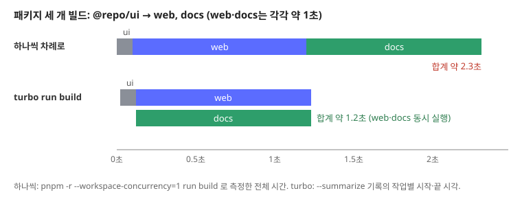

Turborepo는 모노레포 안 여러 패키지의 `build`, `test`, `lint` 같은 작업을 대신 실행해 주는 도구입니다.

모노레포에서 패키지마다 직접 빌드하면 무엇이 불편한지 보고, Turborepo가 `turbo.json` 설정으로 작업 순서를 정하는 방법, 결과를 캐시해 다시 쓰는 방법, 필요한 패키지만 골라 실행하는 방법을 살펴봅니다.

## 모노레포에서 빌드할 때의 문제

**모노레포**는 여러 앱과 라이브러리를 저장소 하나에 두고 관리하는 방식입니다. 예를 들어 서비스 화면(`web`), 문서 사이트(`docs`), 두 앱이 같이 쓰는 UI 컴포넌트(`@repo/ui`)를 한 저장소에 둡니다.

```text
my-monorepo/
├── apps/
│   ├── web/        # @repo/ui를 import
│   └── docs/       # @repo/ui를 import
├── packages/
│   └── ui/         # @repo/ui
├── package.json
└── pnpm-workspace.yaml
```

pnpm, npm, yarn, bun 같은 패키지 매니저의 워크스페이스 기능을 쓰면 `web`이 `@repo/ui`를 npm 패키지처럼 import할 수 있습니다. 하지만 빌드를 직접 실행하면 다음 문제가 생깁니다.

- **순서를 직접 맞춰야 합니다.** `web`은 빌드된 `@repo/ui`를 쓰므로 `@repo/ui`를 먼저 빌드해야 합니다. 패키지가 늘어나면 이 순서를 스크립트로 관리하기 어렵습니다.
- **바뀌지 않은 패키지도 다시 빌드합니다.** `web` 파일 한 줄만 고쳤는데 `docs`와 `@repo/ui`까지 다시 빌드하면 시간이 낭비됩니다.
- **동시에 실행할 수 있는 작업을 차례로 실행합니다.** `web`과 `docs`는 서로 의존하지 않으므로 함께 빌드해도 되지만, 스크립트를 순서대로 나열하면 하나씩 실행됩니다.

## Turborepo란

**Turborepo**는 모노레포의 작업을 실행하는 빌드 도구입니다. Vercel이 만들었고, 명령은 `turbo`입니다.

패키지 설치와 연결은 하지 않습니다. 그 일은 pnpm 같은 패키지 매니저의 워크스페이스가 하고, Turborepo는 각 패키지의 `package.json`에 정의된 스크립트를 읽어 실행합니다. 루트에서 `turbo run build`를 실행하면 모든 패키지의 `build` 스크립트를 찾아, 의존 관계에 맞는 순서로 실행합니다.

설정은 저장소 루트의 `turbo.json`에 둡니다.

```json
{
  "$schema": "https://turborepo.dev/schema.json",
  "tasks": {
    "build": {
      "dependsOn": ["^build"],
      "outputs": ["dist/**"]
    },
    "dev": {
      "cache": false,
      "persistent": true
    }
  }
}
```

`tasks` 아래 키는 `package.json`의 스크립트 이름입니다. 각 작업에 순서(`dependsOn`), 결과 파일 위치(`outputs`), 캐시 여부(`cache`)를 적습니다.

## dependsOn으로 작업 순서 정하기

`"dependsOn": ["^build"]`의 `^`는 "이 패키지가 의존하는 패키지들"을 뜻합니다. 즉 어떤 패키지의 `build`를 실행하기 전에, 그 패키지가 `package.json`에 의존성으로 적은 워크스페이스 패키지의 `build`를 먼저 끝냅니다.

`web`과 `docs`의 `package.json`에 `@repo/ui`가 있으면 Turborepo는 다음 순서를 만듭니다.

```text
@repo/ui#build ──┬──> web#build
                 └──> docs#build
```

`@repo/ui#build`가 끝나면 서로 의존하지 않는 `web#build`와 `docs#build`는 동시에 실행됩니다. 이렇게 작업과 작업 사이 순서를 표현한 것을 **작업 그래프(task graph)** 라고 합니다.

실제로 실행하면 이렇게 출력됩니다.

```text
$ turbo run build
   • Packages in scope: @repo/ui, docs, web
   • Running build in 3 packages
   • Remote caching disabled

@repo/ui:build: cache miss, executing 0e5105c3fe0329b0
@repo/ui:build: ui built
web:build: cache miss, executing 10d66bfd4e04fa94
docs:build: cache miss, executing 7fc0201ffbc31803
docs:build: docs built
web:build: web built

 Tasks:    3 successful, 3 total
Cached:    0 cached, 3 total
  Time:    1.209s
```

`@repo/ui`가 먼저 끝나고, `web`과 `docs`의 로그가 섞여 나오는 것은 둘이 동시에 실행되었기 때문입니다. 같은 세 패키지를 하나씩 차례로 빌드할 때와 비교하면 다음과 같습니다.



`^` 없이 `"dependsOn": ["lint"]`라고 쓰면 같은 패키지 안의 `lint`를 먼저 실행하라는 뜻입니다. 예를 들어 `test`에 `"dependsOn": ["build"]`를 두면 각 패키지는 자기 `build`가 끝난 뒤 `test`를 실행합니다.

`dev`처럼 개발 서버를 실행해 종료되지 않는 작업에는 `"cache": false`와 `"persistent": true`를 둡니다. 개발 서버는 남길 결과 파일이 없으므로 캐시하지 않습니다. `persistent`로 표시한 작업을 다른 작업이 `dependsOn`으로 기다리게 설정하면 Turborepo가 오류로 알려줍니다. 끝나지 않는 작업을 기다리면 그 작업은 시작하지 못하기 때문입니다.

> 💡 **여기까지 정리하면**
>
> - Turborepo는 패키지 매니저 워크스페이스 위에서 각 패키지의 스크립트를 실행합니다.
> - `turbo.json`의 `tasks`에 스크립트 이름별 설정을 적습니다.
> - `"dependsOn": ["^build"]`는 의존하는 패키지의 `build`를 먼저 실행하라는 뜻입니다.
> - 서로 의존하지 않는 작업은 동시에 실행됩니다.

## 캐시는 어떻게 동작할까?

Turborepo는 작업을 실행하기 전에 그 작업의 입력으로 **해시**를 계산합니다. 위 출력의 `0e5105c3fe0329b0`이 그 해시입니다. 해시에 들어가는 주요 입력은 다음과 같습니다.

- 패키지 안의 파일 내용 (`.gitignore`에 적힌 파일 제외)
- `turbo.json`의 작업 설정
- 이 작업이 의존하는 작업들의 해시
- 잠금 파일(`pnpm-lock.yaml` 등)에 기록된 외부 의존성 버전
- 설정에 적은 환경 변수 값 (`env`)

같은 해시로 실행한 기록이 있으면 작업을 실행하지 않고 저장해 둔 결과를 꺼냅니다. 이를 **캐시 히트**라고 합니다. 이때 두 가지를 복원합니다.

- 터미널 로그 — 처음 실행했을 때의 출력을 그대로 다시 보여줍니다.
- `outputs`에 적은 파일 — `dist/**`처럼 지정한 파일을 제자리에 다시 만듭니다.



아무것도 바꾸지 않고 다시 실행하면 세 작업이 모두 캐시 히트입니다.

```text
$ turbo run build
@repo/ui:build: cache hit, replaying logs 0e5105c3fe0329b0
web:build: cache hit, replaying logs 10d66bfd4e04fa94
docs:build: cache hit, replaying logs 7fc0201ffbc31803

 Tasks:    3 successful, 3 total
Cached:    3 cached, 3 total
  Time:    5ms >>> FULL TURBO
```

1.2초 걸리던 빌드가 5ms에 끝났습니다. 모든 작업이 캐시 히트면 `>>> FULL TURBO`가 붙습니다. `web/dist` 폴더를 지운 뒤 다시 실행해도 캐시 히트로 `dist`가 복원됩니다. 반대로 `outputs`를 적지 않으면 로그만 복원되고 빌드 결과 파일은 생기지 않으므로, 결과 파일을 만드는 작업에는 `outputs`를 꼭 적어야 합니다.

### 파일을 바꿨을 때 다시 실행되는 범위

해시에 의존하는 작업의 해시가 들어가므로, 한 패키지를 바꾸면 그 패키지를 쓰는 패키지까지 다시 실행됩니다.

| 바꾼 파일 | `@repo/ui#build` | `web#build` | `docs#build` |
|---|---|---|---|
| `packages/ui/src/index.js` | 다시 실행 | 다시 실행 | 다시 실행 |
| `apps/web` 안의 파일 | 캐시 히트 | 다시 실행 | 캐시 히트 |

### 로컬 캐시와 원격 캐시

캐시는 기본적으로 저장소 루트의 `.turbo/cache`에 저장됩니다. 이 폴더는 로컬 컴퓨터에만 있으므로, 다른 개발자나 CI 서버는 같은 빌드를 처음부터 다시 실행합니다.

**원격 캐시**는 캐시를 서버에 올려 여러 컴퓨터가 함께 쓰게 합니다. 한 개발자가 이미 빌드한 커밋을 다른 개발자가 받아 빌드하면, 같은 해시의 결과를 서버에서 내려받아 실행을 건너뜁니다. Vercel이 제공하는 원격 캐시는 `turbo login`, `turbo link`로 연결하고, 같은 API를 구현한 서버를 직접 운영할 수도 있습니다.



> 💡 **여기까지 정리하면**
>
> - Turborepo는 작업의 입력(파일, 설정, 의존 작업, 환경 변수)으로 해시를 만듭니다.
> - 같은 해시의 기록이 있으면 실행하지 않고 로그와 `outputs` 파일을 복원합니다.
> - 의존하는 패키지가 바뀌면 그 패키지를 쓰는 작업도 다시 실행됩니다.
> - 원격 캐시를 쓰면 다른 컴퓨터에서 만든 캐시도 재사용합니다.

## 필요한 패키지만 실행하기

`--filter`로 실행할 패키지를 고를 수 있습니다.

```bash
turbo run build --filter=web
```

이때 `web#build`만 실행되는 것이 아니라, `^build` 설정에 따라 `web`이 의존하는 `@repo/ui#build`도 함께 실행됩니다.

패키지 이름 앞에 `...`을 붙이면 그 패키지와, 그 패키지를 의존하는 패키지를 모두 고릅니다.

```bash
turbo run build --filter=...@repo/ui
```

`@repo/ui`를 고친 뒤 영향을 받는 `web`과 `docs`까지 빌드해 확인할 때 씁니다.

## 언제 Turborepo를 쓸까?

Turborepo가 잘 맞는 경우입니다.

- **공유 패키지가 있는 모노레포** — 앱 여러 개가 UI, 설정, 타입 패키지를 함께 쓰면 빌드 순서와 재빌드 범위를 자동으로 맞춥니다.
- **CI 시간이 긴 저장소** — 원격 캐시로 바뀌지 않은 패키지의 빌드·테스트를 건너뜁니다.
- **JavaScript·TypeScript 위주의 저장소** — `package.json` 스크립트와 패키지 매니저 워크스페이스를 그대로 씁니다.

맞지 않는 경우도 있습니다.

- **패키지가 하나뿐인 저장소** — 순서를 맞출 패키지가 없으므로 이점이 작습니다.
- **입력이 같아도 결과가 달라지는 작업** — 현재 시각이나 외부 API 응답에 따라 결과가 바뀌는 작업은 캐시하면 오래된 결과가 나옵니다. `"cache": false`로 캐시를 끄거나, 결과에 영향을 주는 환경 변수를 `env`에 적어 해시에 넣습니다.

## 정리

- Turborepo는 모노레포의 패키지별 스크립트를 실행하는 빌드 도구입니다. 패키지 설치는 패키지 매니저 워크스페이스가 하고, Turborepo는 `turbo.json`에 따라 작업을 실행합니다.
- `"dependsOn": ["^build"]`로 의존하는 패키지를 먼저 빌드하고, 서로 의존하지 않는 작업은 동시에 실행합니다.
- 작업의 입력으로 해시를 만들어, 같은 해시면 실행하지 않고 로그와 `outputs` 파일을 복원합니다. 원격 캐시를 쓰면 다른 컴퓨터와 CI에서도 이 결과를 재사용합니다.
- `--filter`로 필요한 패키지와 그 의존 패키지만 골라 실행합니다.
