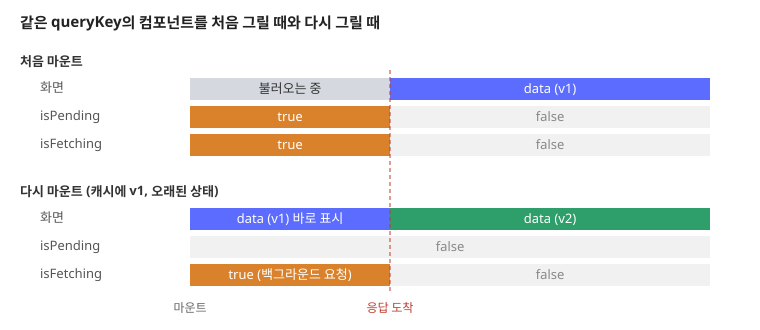

TanStack Query는 브라우저에서 서버 데이터를 가져오고, 캐시해 두고, 필요할 때 다시 가져오는 일을 맡는 라이브러리입니다.

`useEffect`로 데이터를 직접 가져오면 무엇이 불편한지 보고, 쿼리 키로 캐시하는 방식, 오래된 데이터를 다시 가져오는 시점, 데이터를 바꾼 뒤 캐시를 갱신하는 방법을 살펴봅니다. 컴포넌트가 쿼리 키와 데이터를 가져오는 함수를 넘기면, TanStack Query가 캐시에서 값을 꺼내 주고 필요할 때 그 함수를 다시 실행합니다.

## useEffect로 데이터를 가져올 때의 문제

React에서 서버 데이터를 직접 가져오면 보통 이런 코드가 됩니다.

```tsx
function UserName({ id }: { id: number }) {
  const [user, setUser] = useState<User | null>(null);
  const [loading, setLoading] = useState(true);
  const [error, setError] = useState<Error | null>(null);
  useEffect(() => {
    fetch(`/api/users/${id}`)
      .then((res) => res.json())
      .then(setUser)
      .catch(setError)
      .finally(() => setLoading(false));
  }, [id]);
  if (loading) return <p>불러오는 중</p>;
  if (error) return <p>오류</p>;
  return <p>{user?.name}</p>;
}
```

이 방식에는 다음 문제가 있습니다.

- **같은 데이터를 여러 번 요청합니다.** 같은 사용자 정보를 쓰는 컴포넌트가 화면에 둘이면 요청도 두 번 갑니다.
- **다시 들어올 때마다 처음부터 기다립니다.** 다른 페이지에 갔다가 돌아오면 컴포넌트가 새로 마운트되어, 방금 본 데이터인데도 "불러오는 중"부터 다시 보여줍니다.
- **데이터가 오래되어도 모릅니다.** 다른 화면에서 사용자 이름을 바꿔도, 이 컴포넌트는 다시 요청하기 전까지 예전 이름을 보여줍니다.
- **로딩·오류 처리를 매번 씁니다.** 로딩, 오류, 데이터 상태와 재시도를 컴포넌트마다 직접 관리해야 합니다.

## 서버 상태와 클라이언트 상태

화면이 다루는 상태는 두 종류로 나눌 수 있습니다.

| | 서버 상태 | 클라이언트 상태 |
|---|---|---|
| 예 | 사용자 정보, 글 목록, 주문 내역 | 모달 열림 여부, 입력 중인 값, 선택한 탭 |
| 원본 위치 | 서버 | 브라우저 |
| 바뀌는 시점 | 다른 사용자나 다른 화면이 언제든 바꿀 수 있음 | 이 화면의 코드가 바꿀 때만 |
| 읽는 비용 | 네트워크 요청이 필요함 | 바로 읽음 |

**서버 상태**는 브라우저가 가진 값이 원본의 복사본일 뿐이라, 언제 다시 가져올지와 복사본이 얼마나 오래되었는지를 관리해야 합니다. TanStack Query는 이 서버 상태를 다루는 도구입니다.

## TanStack Query란

**TanStack Query**는 서버 상태를 가져오고 캐시하는 라이브러리입니다. React용 패키지는 `@tanstack/react-query`입니다.

앱 위쪽에서 `QueryClient`를 만들어 `QueryClientProvider`로 넘깁니다. `QueryClient`가 캐시를 갖고 있고, 아래의 모든 컴포넌트가 이 캐시를 함께 씁니다.

```tsx
import { QueryClient, QueryClientProvider } from '@tanstack/react-query';

const queryClient = new QueryClient();

export function App() {
  return (
    <QueryClientProvider client={queryClient}>
      <UserName id={1} />
    </QueryClientProvider>
  );
}
```

컴포넌트에서는 `useQuery`에 쿼리 키와 데이터를 가져오는 함수를 넘깁니다.

```tsx
import { useQuery } from '@tanstack/react-query';

function UserName({ id }: { id: number }) {
  const { data, isPending, error } = useQuery({
    queryKey: ['user', id],
    queryFn: () => fetch(`/api/users/${id}`).then((res) => res.json()),
  });
  if (isPending) return <p>불러오는 중</p>;
  if (error) return <p>오류</p>;
  return <p>{data.name}</p>;
}
```

**쿼리 키**(`queryKey`)는 캐시에서 데이터를 찾는 이름입니다. 배열로 쓰고, 데이터를 구분하는 값(위에서는 `id`)을 함께 넣습니다. 키가 같으면 같은 데이터로 봅니다. 같은 키를 쓰는 컴포넌트 두 개를 동시에 그려도 `queryFn`은 한 번만 실행되고, 두 컴포넌트가 같은 결과를 받습니다.

![useEffect로 직접 요청하면 Header와 Profile이 각각 GET /api/users/1을 보내고, useQuery는 두 컴포넌트가 ['user', 1] 캐시 하나를 함께 써서 요청이 한 번만 가는 비교](./images/frontend-2-dedupe.svg)

`queryFn`이 실패하면 기본으로 3번 더 시도합니다. 시도 간격은 1초, 2초, 4초처럼 두 배씩 늘어나고 최대 30초입니다. 3번 모두 실패하면 `error`에 오류가 담깁니다.

## 캐시는 어떻게 동작할까?

### 신선한 데이터와 오래된 데이터

캐시에 든 데이터는 **신선한(fresh)** 상태이거나 **오래된(stale)** 상태입니다. 데이터를 받은 뒤 `staleTime`이 지나면 오래된 상태가 됩니다. `staleTime`의 기본값은 0이라, 받자마자 오래된 데이터가 됩니다.

오래된 데이터도 화면에는 그대로 보여줍니다. 대신 다음 시점에 백그라운드에서 다시 가져옵니다.

- 같은 키를 쓰는 컴포넌트가 새로 마운트될 때
- 브라우저 창에 다시 포커스가 갈 때
- 네트워크가 다시 연결될 때

그래서 다른 페이지에 갔다가 돌아오면, 캐시에 있던 데이터를 바로 보여주고 동시에 새 데이터를 요청합니다. 새 데이터가 오면 화면이 바뀝니다.

이 차이는 `useQuery`가 돌려주는 두 값으로 구분합니다.

- `isPending` — 캐시에 데이터가 아직 없음
- `isFetching` — 지금 요청 중 (백그라운드 요청 포함)



"불러오는 중" 화면은 `isPending`일 때만 보여주고, 백그라운드에서 다시 가져오는 동안은 기존 데이터를 그대로 둡니다.

`staleTime`을 늘리면 그 시간 동안은 다시 가져오지 않습니다. 자주 바뀌지 않는 데이터에 쓰면 요청 수가 줄어듭니다.

```tsx
const queryClient = new QueryClient({
  defaultOptions: { queries: { staleTime: 60_000 } }, // 1분 동안 신선한 데이터로 봄
});
```

### 쓰지 않는 데이터 지우기

어떤 키를 쓰는 컴포넌트가 화면에서 모두 사라져도, 데이터는 바로 지워지지 않고 캐시에 남습니다. 그 상태로 `gcTime`(기본 5분)이 지나면 캐시에서 지웁니다. 그 전에 같은 키를 다시 쓰면 남아 있던 데이터를 바로 보여줄 수 있습니다.



> 💡 **여기까지 정리하면**
>
> - TanStack Query는 쿼리 키로 서버 데이터를 캐시하고, 같은 키를 쓰는 컴포넌트는 요청 하나를 함께 씁니다.
> - 데이터는 `staleTime`(기본 0)이 지나면 오래된 상태가 되고, 마운트·창 포커스·재연결 때 백그라운드에서 다시 가져옵니다.
> - `isPending`은 데이터가 아직 없을 때, `isFetching`은 요청 중일 때 `true`입니다.
> - 쓰지 않는 데이터는 `gcTime`(기본 5분) 뒤에 지우고, 실패한 요청은 3번 더 시도합니다.

## 데이터를 바꾼 뒤 캐시 갱신하기

서버의 데이터를 바꾸는 요청은 `useMutation`으로 보냅니다. 요청이 성공하면 `invalidateQueries`로 관련 쿼리를 오래된 상태로 표시합니다. 그 키를 쓰는 컴포넌트가 화면에 있으면 바로 다시 가져옵니다.

```tsx
import { useMutation, useQueryClient } from '@tanstack/react-query';

function RenameButton({ id }: { id: number }) {
  const queryClient = useQueryClient();
  const rename = useMutation({
    mutationFn: (name: string) =>
      fetch(`/api/users/${id}`, { method: 'PATCH', body: JSON.stringify({ name }) }),
    onSuccess: () => queryClient.invalidateQueries({ queryKey: ['user', id] }),
  });
  return <button onClick={() => rename.mutate('lee')}>이름 바꾸기</button>;
}
```

![버튼이 mutate를 부르면 useMutation이 서버에 PATCH를 보내고, 성공하면 invalidateQueries로 ['user', 1]을 오래된 상태로 표시해 화면의 useQuery가 GET으로 다시 가져와 새 이름으로 그리는 시퀀스](./images/frontend-2-invalidate.svg)

`invalidateQueries`는 키의 앞부분만 맞아도 해당 쿼리를 모두 표시합니다. `{ queryKey: ['user'] }`로 부르면 `['user', 1]`, `['user', 2]`가 모두 오래된 상태가 됩니다.

작업 진행 상태처럼 서버에서 계속 바뀌는 값은 `refetchInterval`로 주기적으로 다시 가져옵니다.

```tsx
useQuery({
  queryKey: ['job', jobId],
  queryFn: () => fetchJob(jobId),
  refetchInterval: 1000, // 1초마다 다시 가져옴
});
```

## 언제 TanStack Query를 쓸까?

TanStack Query가 잘 맞는 경우입니다.

- **서버 데이터를 많이 보여주는 화면** — 목록, 상세, 대시보드처럼 API 응답을 그리는 화면에서 로딩·오류·캐시 코드를 줄입니다.
- **같은 데이터를 여러 곳에서 쓰는 화면** — 쿼리 키 하나로 요청과 결과를 함께 씁니다.
- **데이터를 바꾼 뒤 다른 화면도 갱신해야 할 때** — `invalidateQueries`로 관련 쿼리를 한 번에 다시 가져옵니다.
- **주기적으로 상태를 확인해야 할 때** — `refetchInterval`로 폴링합니다.

맞지 않는 경우도 있습니다.

- **클라이언트 상태** — 모달 열림 여부나 입력 중인 값은 서버에 원본이 없으므로 `useState`나 상태 관리 라이브러리로 다룹니다.
- **서버에서 그리고 끝나는 데이터** — 서버 컴포넌트가 읽어 그리기만 하고 브라우저에서 다시 가져올 일이 없다면 필요하지 않습니다.

## 정리

- TanStack Query는 서버 상태를 다루는 라이브러리입니다. 쿼리 키로 데이터를 캐시하고, 같은 키를 쓰는 컴포넌트는 요청과 결과를 함께 씁니다.
- 받은 데이터는 `staleTime`이 지나면 오래된 상태가 되고, 화면에는 그대로 보여주면서 마운트·창 포커스·재연결 때 백그라운드에서 다시 가져옵니다.
- 쓰지 않는 데이터는 `gcTime` 뒤에 지우고, 실패한 요청은 간격을 늘려 가며 다시 시도합니다.
- 데이터를 바꾼 뒤에는 `useMutation`과 `invalidateQueries`로 관련 쿼리를 다시 가져옵니다.
