Zustand는 여러 컴포넌트가 함께 쓰는 브라우저 상태를 스토어 하나에 두고 다루는 React 상태 관리 라이브러리입니다.

여러 컴포넌트가 같은 상태를 쓸 때 무엇이 불편한지 보고, 스토어를 만들고 바꾸는 방법, 셀렉터로 필요한 값만 구독하는 방법, Next.js에서 쓸 때 주의할 점을 살펴봅니다. 스토어가 상태와 그 상태를 바꾸는 함수를 함께 갖고, 컴포넌트는 셀렉터로 필요한 값만 꺼내 씁니다.

## 여러 컴포넌트가 같은 상태를 쓸 때의 문제

장바구니 개수를 헤더와 상품 목록이 함께 보여주는 경우, `useState`로 관리하면 두 컴포넌트의 공통 부모에 상태를 두고 props로 내려야 합니다.

- **중간 컴포넌트가 props를 전달만 합니다.** 상태를 쓰지 않는 컴포넌트도 아래로 넘기기 위해 props를 받아야 합니다. 트리가 깊어질수록 전달 코드가 늘어납니다.
- **부모가 다시 그려지면 아래도 다시 그려집니다.** 상태가 바뀌면 상태를 가진 부모와 그 아래 컴포넌트가 다시 그려집니다.

React Context를 쓰면 props 전달은 없어지지만, Context 값이 바뀔 때 그 Context를 읽는 컴포넌트가 모두 다시 그려집니다. 값 하나만 쓰는 컴포넌트도 Context 안의 다른 값이 바뀌면 다시 그려집니다. Provider로 트리를 감싸는 코드도 필요합니다.

## Zustand란

**Zustand**는 상태를 컴포넌트 밖의 스토어에 두는 라이브러리입니다. `create`로 스토어를 만들면 그 스토어를 읽는 훅이 돌아옵니다. Provider로 감쌀 필요가 없습니다.

```tsx
import { create } from 'zustand';

type CartState = {
  count: number;
  owner: string;
  add: () => void;
  clear: () => void;
};

export const useCartStore = create<CartState>()((set) => ({
  count: 0,
  owner: 'kim',
  add: () => set((state) => ({ count: state.count + 1 })),
  clear: () => set({ count: 0 }),
}));
```

스토어에는 값(`count`, `owner`)과 값을 바꾸는 함수(`add`, `clear`)를 함께 둡니다. 함수 안에서 `set`을 부르면 상태가 바뀌고, 그 값을 쓰는 컴포넌트가 다시 그려집니다.

컴포넌트에서는 훅을 부르고, 필요한 값을 꺼내는 함수를 넘깁니다.

```tsx
function CartBadge() {
  const count = useCartStore((state) => state.count);
  return <span>{count}</span>;
}

function AddButton() {
  const add = useCartStore((state) => state.add);
  return <button onClick={add}>담기</button>;
}
```

### set이 상태를 합치는 방식

`set`에 넘긴 객체는 기존 상태와 합쳐집니다. `set({ count: 0 })`을 불러도 `owner`와 함수들은 그대로 남습니다.

다만 합치는 것은 최상위 한 단계뿐입니다. 상태 안에 객체가 있으면 그 안의 값은 직접 펼쳐서 합쳐야 합니다.

```ts
// address 안의 city만 바꾸기
set((state) => ({ address: { ...state.address, city: 'Seoul' } }));
```

`{ ...state.address }` 없이 `set({ address: { city: 'Seoul' } })`라고 쓰면 `address`의 다른 값이 사라집니다.

## 셀렉터로 필요한 값만 구독하기

`useCartStore((state) => state.count)`에 넘긴 함수를 **셀렉터**라고 합니다. 컴포넌트는 셀렉터가 돌려준 값이 바뀔 때만 다시 그려집니다.

컴포넌트 네 개를 그려 두고 `add`를 두 번 불러 각 컴포넌트가 그려진 횟수를 세면 다음과 같습니다. 처음 그린 1번이 포함된 횟수입니다.

| 컴포넌트가 구독한 값 | 그려진 횟수 |
|---|---|
| `(state) => state.count` | 3 |
| `(state) => state.owner` | 1 |
| 셀렉터 없이 `useCartStore()` (스토어 전체) | 3 |
| `useShallow((state) => ({ owner: state.owner }))` | 1 |

`owner`만 구독한 컴포넌트는 `count`가 바뀌어도 다시 그려지지 않습니다. 셀렉터 없이 스토어 전체를 받으면 어떤 값이 바뀌어도 다시 그려지므로, 필요한 값만 셀렉터로 꺼내 씁니다. `count`가 바뀔 때 다시 그려지는 컴포넌트(빨간색)를 props·Context와 비교하면 다음과 같습니다.



### 객체를 돌려주는 셀렉터

값 여러 개를 객체로 묶어 꺼내면 문제가 생깁니다.

```tsx
const { count, owner } = useCartStore((state) => ({ count: state.count, owner: state.owner }));
```

이 셀렉터는 부를 때마다 새 객체를 만듭니다. Zustand는 셀렉터 결과가 이전과 같은지 `Object.is`로 비교하므로, 내용이 같아도 매번 바뀐 값으로 판단합니다. Zustand 5에서는 이 때문에 다시 그리기가 끝없이 반복되어 다음 오류가 납니다.

```text
The result of getSnapshot should be cached to avoid an infinite loop
Maximum update depth exceeded.
```

객체로 꺼내야 할 때는 `useShallow`로 감쌉니다. `useShallow`는 객체의 각 값을 하나씩 비교해, 모두 같으면 이전 객체를 그대로 돌려줍니다.

```tsx
import { useShallow } from 'zustand/react/shallow';

const { count, owner } = useCartStore(
  useShallow((state) => ({ count: state.count, owner: state.owner })),
);
```

> 💡 **여기까지 정리하면**
>
> - Zustand는 `create`로 스토어를 만들고, 그 스토어를 읽는 훅을 돌려줍니다. Provider가 필요 없습니다.
> - `set`은 넘긴 객체를 최상위 한 단계만 기존 상태와 합칩니다.
> - 셀렉터가 돌려준 값이 바뀔 때만 컴포넌트가 다시 그려집니다.
> - 셀렉터에서 새 객체를 만들면 끝없이 다시 그리므로 `useShallow`로 감쌉니다.

## 컴포넌트 밖에서 상태 다루기

스토어는 컴포넌트 밖에 있으므로 React 바깥 코드에서도 읽고 바꿀 수 있습니다.

```ts
useCartStore.getState().count; // 지금 값 읽기
useCartStore.getState().add(); // 스토어의 함수 부르기
useCartStore.setState({ count: 0 }); // 값 바꾸기
```

이벤트 핸들러에서 최신 값을 한 번만 읽거나, API 응답을 처리하는 함수에서 상태를 바꿀 때 씁니다. `getState()`는 값을 읽기만 하고 구독하지 않으므로, 컴포넌트 안에서 화면에 보여줄 값은 훅과 셀렉터로 읽습니다.

## Next.js에서 쓸 때 주의할 점

`create`로 만든 스토어는 모듈 안의 전역 변수입니다. 브라우저에서는 사용자 한 명이 쓰므로 문제가 없지만, 서버는 여러 사용자의 요청을 동시에 처리합니다. 서버에서 이 스토어에 값을 쓰면 다른 사용자의 요청에서도 그 값이 보일 수 있습니다.



Zustand 문서는 Next.js에서 다음을 권합니다.

- **요청마다 스토어를 새로 만듭니다.** `zustand/vanilla`의 `createStore`로 스토어를 만드는 함수를 두고, 클라이언트 컴포넌트인 Provider 안에서 한 번만 만들어 Context로 내려줍니다.
- **서버 컴포넌트에서는 스토어를 읽거나 쓰지 않습니다.** 서버 컴포넌트는 훅과 Context를 쓸 수 없고, 상태를 갖는 컴포넌트가 아닙니다.

## 언제 Zustand를 쓸까?

Zustand가 잘 맞는 경우입니다.

- **여러 컴포넌트가 함께 쓰는 브라우저 상태** — 장바구니, 편집기의 선택 상태, 사이드바 열림 여부처럼 트리 여러 곳에서 읽고 바꾸는 값.
- **자주 바뀌는 상태** — 셀렉터로 구독 범위를 좁혀, 값이 바뀔 때 다시 그리는 컴포넌트를 줄입니다.
- **React 밖에서도 다뤄야 하는 상태** — `getState`, `setState`로 컴포넌트 밖에서 읽고 바꿉니다.

맞지 않는 경우도 있습니다.

- **서버 데이터** — API 응답은 원본이 서버에 있어 다시 가져오는 시점과 캐시를 관리해야 합니다. 서버 상태 전용 라이브러리가 더 맞습니다.
- **한 컴포넌트 안에서만 쓰는 상태** — 입력창 하나의 값처럼 다른 곳에서 읽지 않는 상태는 `useState`로 충분합니다.

## 정리

- Zustand는 여러 컴포넌트가 함께 쓰는 상태를 컴포넌트 밖 스토어에 두는 라이브러리입니다. `create`로 만든 훅을 부르면 되고 Provider가 필요 없습니다.
- `set`은 최상위 한 단계만 기존 상태와 합치므로, 중첩된 객체는 직접 펼쳐서 합칩니다.
- 셀렉터로 필요한 값만 구독하면 그 값이 바뀔 때만 다시 그려집니다. 객체를 돌려주는 셀렉터는 `useShallow`로 감쌉니다.
- Next.js에서는 서버가 여러 요청을 함께 처리하므로 요청마다 스토어를 만들고, 서버 컴포넌트에서는 스토어를 쓰지 않습니다.
