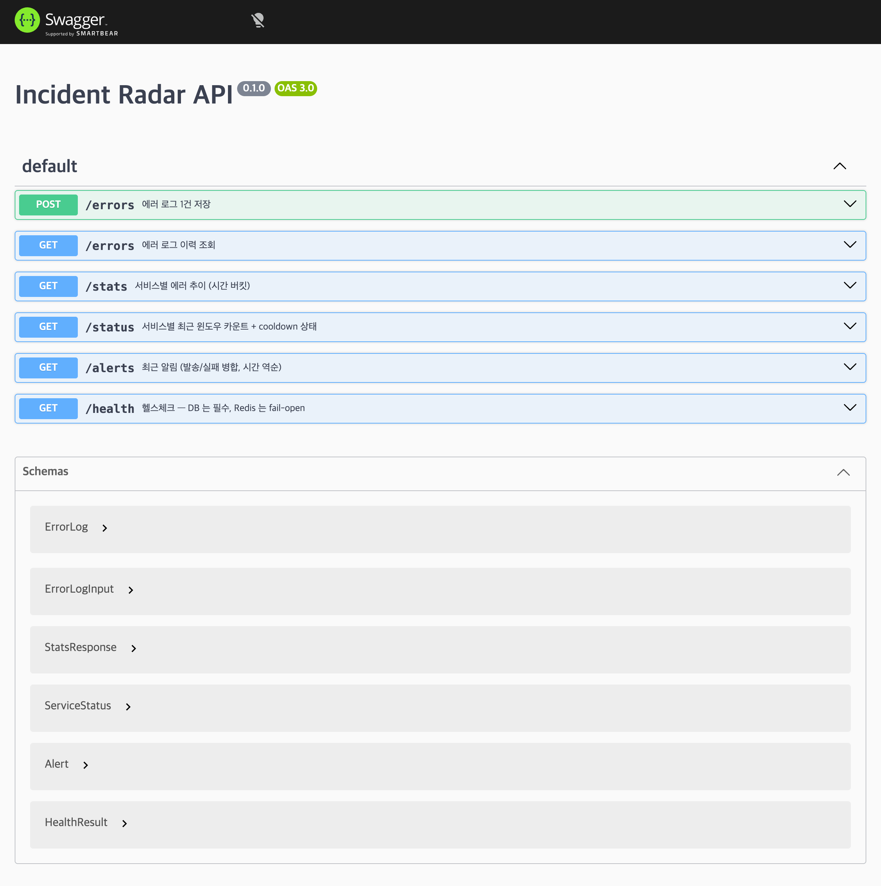

10편에서 프론트 대시보드를 마무리하고 백엔드로 돌아왔습니다.

코어 기능은 다 동작하므로, 이번 편은 새 기능이 아니라 지금까지 만든 백엔드를 배포하고 운영할 수 있는 상태로 마무리하는 작업입니다. 스텁이던 `/health`를 실제 DB·Redis 상태에 연결하고, GitHub Actions CI로 검증을 자동화하고, OpenAPI 문서·구조화 로깅·helmet·레이트리밋을 차례로 붙입니다.

서비스가 자기 상태를 보고하게 만들고(`/health`), 그 검증을 자동화한 뒤(CI), 외부로 드러나는 표면인 문서·로그·보안을 정리하는 순서입니다.

## /health를 실제 상태에 연결하기

지금까지 `/health`는 DB가 죽어도, Redis가 죽어도 `{ status: "ok" }`만 반환하는 스텁이었습니다.

이 서비스에서 DB는 에러 로그를 저장하고 대시보드 조회에 사용하는 핵심 의존성입니다. DB에 접근할 수 없으면 정상 동작으로 볼 수 없으므로 `503`을 반환합니다.

반면 Redis는 8편에서 다룬 것처럼 fail-open으로 설계했습니다. Redis가 다운되어도 DB fallback으로 에러 감지는 계속되므로 HTTP 상태는 `200`으로 유지하고, 대신 `degraded` 상태를 반환합니다.

```ts
// apps/backend/src/health/health.service.ts

async check(): Promise<HealthResult> {
  await this.checkDb();

  return this.redisHealth.healthy
    ? { status: "ok" }
    : { status: "degraded", redis: "down" };
}
```

DB는 실제 쿼리로 확인합니다.

```ts
private async checkDb(): Promise<void> {
  let timer!: NodeJS.Timeout;

  const timeout = new Promise<never>((_, reject) => {
    timer = setTimeout(
      () => reject(new Error("db health check timeout")),
      HealthService.DB_TIMEOUT_MS,
    );
  });

  try {
    await Promise.race([
      this.dataSource.query("SELECT 1"),
      timeout,
    ]);
  } catch (err) {
    this.logger.error(
      `db health check failed: ${describeError(err)}`,
    );

    throw new ServiceUnavailableException("db unavailable");
  } finally {
    clearTimeout(timer);
  }
}
```

`SELECT 1`에 1.5초 타임아웃을 둔 이유는 DB 연결이나 응답이 예상보다 오래 걸릴 때 헬스체크 요청까지 계속 대기하지 않도록 하기 위해서입니다.

`Promise.race`로 DB 응답과 타임아웃 중 먼저 끝나는 쪽을 사용하고, 어느 쪽이 먼저 끝나든 타이머는 `finally`에서 정리합니다.

다만 이 타임아웃이 이미 시작된 DB 쿼리를 취소하는 것은 아닙니다.

로직을 검증하려고 실제 로컬 Postgres 컨테이너를 내리고 `/health`를 호출했습니다. `503`은 정상적으로 반환됐지만, 로그에는 `db health check failed:`처럼 원인이 빈 문자열로 찍혔습니다.

Postgres 연결 실패가 `AggregateError`(IPv4·IPv6 양쪽 연결 시도가 각각 실패한 걸 하나로 묶은 것)로 전달됐는데, 이 객체는 최상위 `message`가 비어 있고 실제 원인은 내부 `errors` 배열에 있었습니다.

```ts
function describeError(err: unknown): string {
  if (err instanceof AggregateError) {
    const inner = err.errors
      .map((e) => (e instanceof Error ? e.message : String(e)))
      .join("; ");
    const code = (err as NodeJS.ErrnoException).code;

    return inner || code || err.message || String(err);
  }

  if (err instanceof Error) {
    const code = (err as NodeJS.ErrnoException).code;

    return err.message || code || String(err);
  }

  return String(err);
}
```

이제 같은 상황에서 로그에 실제 연결 실패 원인이 남습니다.

```text
connect ECONNREFUSED ::1:5432;
connect ECONNREFUSED 127.0.0.1:5432
```

Postgres와 Redis를 각각 내려 세 가지 상태를 확인했습니다.

| DB | Redis | 응답                                          |
| -- | ----- | ------------------------------------------- |
| 정상 | 정상    | `200 { status: "ok" }`                      |
| 정상 | 다운    | `200 { status: "degraded", redis: "down" }` |
| 다운 | 상태 무관 | `503`                                       |

## GitHub Actions CI

다음으로 `push`와 `pull request`마다 lint·typecheck·test를 자동으로 실행하는 CI를 만들었습니다.

```yaml
# .github/workflows/ci.yml (일부)

- uses: actions/checkout@v4

- uses: pnpm/action-setup@v4
  with:
    version: 9.15.0

- uses: actions/setup-node@v4
  with:
    node-version-file: .nvmrc
    cache: pnpm

- run: pnpm install --frozen-lockfile

- run: pnpm lint

- run: pnpm typecheck

- run: pnpm test
```

백엔드의 `test` 스크립트는 이미 `docker-compose.test.yml`로 Postgres와 Redis를 띄우고, 마이그레이션까지 실행하도록 만들어 두었습니다.

CI 전용으로 GitHub Actions `services`를 다시 정의하지 않고 기존 compose 구성을 그대로 사용해서, 로컬과 CI가 같은 인프라 구성을 씁니다.

실제로 push해서 GitHub Actions가 초록으로 끝나는 것까지 확인했습니다.

## API 문서는 Zod 스키마를 기준으로 만든다

이 프로젝트의 요청·응답 검증은 전부 Zod 스키마로 합니다.

그래서 Nest의 일반적인 Swagger 방식처럼 DTO 클래스에 `@ApiProperty()`를 붙이면 검증용 Zod 스키마와 문서용 DTO를 따로 관리하게 됩니다.

대신 이미 사용하는 Zod 스키마를 OpenAPI 문서 생성에도 그대로 사용했습니다.

```ts
// apps/backend/src/openapi/openapi.document.ts (일부)

const registry = new OpenAPIRegistry();

const ErrorLogSchema = registry.register("ErrorLog", ErrorLog);

const StatsResponseSchema = registry.register(
  "StatsResponse",
  StatsResponse,
);

registry.registerPath({
  method: "post",
  path: "/errors",
  summary: "에러 로그 1건 저장",

  request: {
    body: {
      content: {
        "application/json": {
          schema: ErrorLogInputSchema,
        },
      },
    },
  },

  responses: {
    201: {
      description: "생성됨",
      content: {
        "application/json": {
          schema: ErrorLogSchema,
        },
      },
    },
  },
});
```

컨트롤러에는 `@ApiResponse` 같은 데코레이터를 하나도 안 붙였습니다. 경로·스키마 정의가 이 파일 한 곳에 모여 있어서, 응답 모양이 바뀌면 검증 스키마 하나만 고치면 문서도 같이 맞습니다. `/health`만 프론트가 안 써서 공유 스키마가 없는데, 이건 문서 전용으로 이 파일 안에 따로 작은 Zod 스키마를 정의했습니다.

검증과 문서가 같은 스키마를 보므로 필드가 바뀌면 둘 다 자동으로 따라옵니다. 프론트도 응답을 같은 스키마로 파싱하기 때문에, 모양이 안 맞으면 조용히 깨지는 대신 파싱 에러로 바로 드러납니다. 다만 그 필드를 실제로 쓰는 로직(백엔드 처리, 화면 표시)은 여전히 코드로 짜야 하고, 엔드포인트 자체가 새로 생기면 `registerPath`는 직접 추가해야 합니다.

만들어진 문서는 `SwaggerModule.setup`으로 UI와 JSON을 같이 서빙합니다.

```ts
// apps/backend/src/main.ts (일부)
SwaggerModule.setup("docs", app, buildOpenApiDocument());
```

`curl /docs-json`으로 경로 5개·스키마 6개, `/docs`에서 Swagger UI 렌더까지 확인했습니다.



## 구조화 로깅

지금까지 로그는 Nest 기본 `Logger`가 문자열을 그대로 찍는 방식이었습니다.

`pino`는 Node.js용 로깅 라이브러리입니다. 로그를 텍스트가 아니라 JSON처럼 구조화된 형태로 남겨서, 나중에 특정 필드로 검색하거나 집계하기 쉽게 해줍니다. `nestjs-pino`로 이 프로젝트에 붙여서, dev는 사람이 읽기 좋게, prod는 JSON 한 줄로 나가게 했습니다.

```ts
// apps/backend/src/main.ts (일부)
const app = await NestFactory.create(AppModule, { bufferLogs: true });
app.useLogger(app.get(Logger));
```

`app.useLogger()`는 Nest의 `Logger` 클래스를 전역으로 교체하는 기능입니다. 기존 서비스들이 쓰던 `new Logger(ClassName.name)` 호출부는 하나도 안 건드렸는데도, 그 로그들이 전부 pino를 거쳐 나갑니다. 예를 들어 `DetectorService`가 남기던 로그는 요청 한 번에 이렇게 나옵니다.

```
[07:50:25] INFO: DetectorService: ingest path=redis service=checkout count=1 enqueued=false latencyMs=20 {"req":{"method":"POST","url":"/errors"}}
```

`ingest path=...` 부분은 7편에서 만든 원래 로그 그대로입니다. 뒤에 붙은 `req` 정보는 `pino-http`가 자동으로 붙여준 것입니다. 이 로그가 어느 요청 처리 중에 찍혔는지, 코드를 안 건드리고 공짜로 얻었습니다.

기본 설정을 그대로 뒀을 땐 문제가 두 가지 있었습니다. 하나는 테스트를 돌릴 때마다 모든 요청·응답이 로그로 통째로 찍혀서 실패가 로그 더미에 묻히는 것이었고, 다른 하나는 dev·prod 모두에서 요청 로그 한 줄에 헤더 전체가 raw JSON으로 찍히는 것이었습니다. `NODE_ENV=test`일 때는 자동 요청 로깅을 끄고, 필요한 필드(`method`·`url`·`statusCode`)만 남기게 줄였습니다.

```ts
// apps/backend/src/app.module.ts (일부)
pinoHttp: {
  autoLogging: config.get("NODE_ENV", { infer: true }) !== "test",
  serializers: {
    req: (req: { method: string; url: string }) => ({ method: req.method, url: req.url }),
    res: (res: { statusCode: number }) => ({ statusCode: res.statusCode }),
  },
}
```

## 보안 마무리

이 섹션에서는 helmet, `POST /errors` 레이트리밋, CORS 검증까지 세 가지를 다룹니다.

helmet은 요청마다 보안 관련 HTTP 응답 헤더를 자동으로 붙여주는 미들웨어입니다. 브라우저가 응답을 다른 사이트의 `<iframe>`에 못 넣게 막는 `X-Frame-Options`, 브라우저가 파일 타입을 제멋대로 추측하지 못하게 하는 `X-Content-Type-Options` 같은 헤더들이 붙습니다.

```ts
// apps/backend/src/main.ts (일부)
app.use(helmet());
```

레이트리밋은 `POST /errors`에만 겁니다. `ThrottlerModule`은 앱 전체에 등록하지만, 가드는 `ErrorsController`의 `create` 메서드 하나에만 붙여서 이 엔드포인트만 제한합니다.

```ts
// apps/backend/src/errors/errors.controller.ts (일부)
@Post()
@UseGuards(ThrottlerGuard)
async create(@Body(new ZodValidationPipe(ErrorLogInput)) body: ErrorLogInput) {
```

한도는 IP 기준 분당 `RATE_LIMIT_PER_MIN`(기본 600)건이고, 시뮬레이터·부하테스트 트래픽은 `X-Load-Test` 헤더가 있으면 `skipIf`로 카운트 자체를 건너뜁니다.

```ts
// apps/backend/src/app.module.ts (일부)
skipIf: (context) =>
  context.switchToHttp().getRequest().headers["x-load-test"] !== undefined,
```

CORS(`CORS_ORIGIN` env로 오리진 명시)는 9편 프론트 작업 때 이미 붙여뒀던 걸 이번엔 검증만 했습니다. 그런데 `curl`로는 검증이 안 됩니다. CORS는 브라우저가 강제하는 정책이라, curl은 서버가 보낸 `Access-Control-Allow-Origin` 헤더 값과 무관하게 응답을 그냥 다 받아버립니다. 실제로 차단되는지 보려면 진짜 브라우저가 필요해서, 허용 안 된 origin에서 `fetch`를 날려봤습니다.

```
Access to fetch at 'http://localhost:3000/health' from origin 'http://localhost:9999'
has been blocked by CORS policy: The 'Access-Control-Allow-Origin' header has a value
'http://localhost:3001' that is not equal to the supplied origin.
```

허용된 origin(`localhost:3001`)에서는 같은 요청이 정상적으로 통과하는 것도 대조 확인했습니다.
