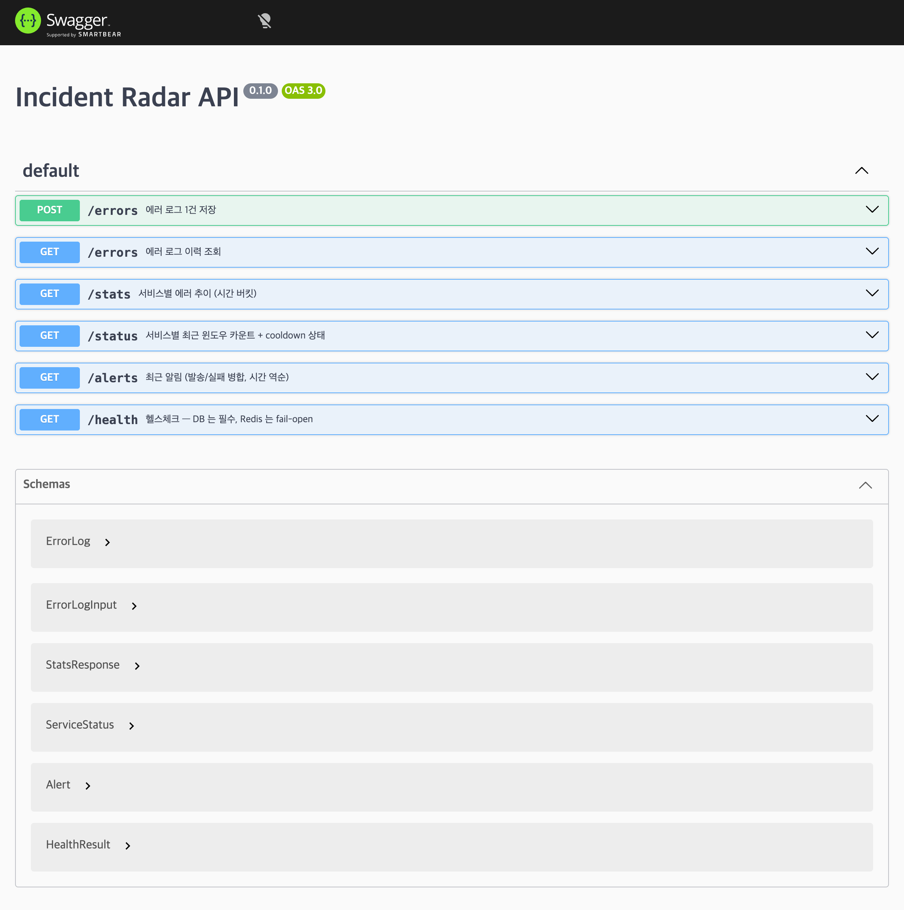

11편에서 `/health`와 CI를 끝냈습니다.

이번 편에서는 API 문서, 구조화 로깅, 보안을 순서대로 정리합니다.

기능을 새로 추가하는 것보다, 지금까지 만든 시스템을 외부에서 이해하고 운영할 수 있는 형태로 마무리하는 작업에 가깝습니다.

## API 문서는 Zod 스키마를 기준으로 만든다

이 프로젝트의 요청·응답 검증은 전부 Zod 스키마로 합니다.

그래서 Nest의 일반적인 Swagger 방식처럼 DTO 클래스에 `@ApiProperty()`를 붙이면 검증용 Zod 스키마와 문서용 DTO를 따로 관리하게 됩니다.

대신 이미 사용하는 Zod 스키마를 OpenAPI 문서 생성에도 그대로 사용했습니다.

```ts
// apps/backend/src/openapi/openapi.document.ts (일부)

const registry = new OpenAPIRegistry();

const ErrorLogSchema = registry.register("ErrorLog", ErrorLog);

const StatsResponseSchema = registry.register(
  "StatsResponse",
  StatsResponse,
);

registry.registerPath({
  method: "post",
  path: "/errors",
  summary: "에러 로그 1건 저장",

  request: {
    body: {
      content: {
        "application/json": {
          schema: ErrorLogInputSchema,
        },
      },
    },
  },

  responses: {
    201: {
      description: "생성됨",
      content: {
        "application/json": {
          schema: ErrorLogSchema,
        },
      },
    },
  },
});
```

컨트롤러에는 `@ApiResponse` 같은 데코레이터를 하나도 안 붙였습니다. 경로·스키마 정의가 이 파일 한 곳에 모여 있어서, 응답 모양이 바뀌면 검증 스키마 하나만 고치면 문서도 같이 맞습니다. `/health`만 프론트가 안 써서 공유 스키마가 없는데, 이건 문서 전용으로 이 파일 안에 따로 작은 Zod 스키마를 정의했습니다.

검증과 문서가 같은 스키마를 보므로 필드가 바뀌면 둘 다 자동으로 따라옵니다. 프론트도 응답을 같은 스키마로 파싱하기 때문에, 모양이 안 맞으면 조용히 깨지는 대신 파싱 에러로 바로 드러납니다. 다만 그 필드를 실제로 쓰는 로직(백엔드 처리, 화면 표시)은 여전히 코드로 짜야 하고, 엔드포인트 자체가 새로 생기면 `registerPath`는 직접 추가해야 합니다.

만들어진 문서는 `SwaggerModule.setup`으로 UI와 JSON을 같이 서빙합니다.

```ts
// apps/backend/src/main.ts (일부)
SwaggerModule.setup("docs", app, buildOpenApiDocument());
```

`curl /docs-json`으로 경로 5개·스키마 6개, `/docs`에서 Swagger UI 렌더까지 확인했습니다.



## 구조화 로깅

지금까지 로그는 Nest 기본 `Logger`가 문자열을 그대로 찍는 방식이었습니다.

`pino`는 Node.js용 로깅 라이브러리입니다. 로그를 텍스트가 아니라 JSON처럼 구조화된 형태로 남겨서, 나중에 특정 필드로 검색하거나 집계하기 쉽게 해줍니다. `nestjs-pino`로 이 프로젝트에 붙여서, dev는 사람이 읽기 좋게, prod는 JSON 한 줄로 나가게 했습니다.

```ts
// apps/backend/src/main.ts (일부)
const app = await NestFactory.create(AppModule, { bufferLogs: true });
app.useLogger(app.get(Logger));
```

`app.useLogger()`는 Nest의 `Logger` 클래스를 전역으로 교체하는 기능입니다. 기존 서비스들이 쓰던 `new Logger(ClassName.name)` 호출부는 하나도 안 건드렸는데도, 그 로그들이 전부 pino를 거쳐 나갑니다. 예를 들어 `DetectorService`가 남기던 로그는 요청 한 번에 이렇게 나옵니다.

```
[07:50:25] INFO: DetectorService: ingest path=redis service=checkout count=1 enqueued=false latencyMs=20 {"req":{"method":"POST","url":"/errors"}}
```

`ingest path=...` 부분은 7편에서 만든 원래 로그 그대로입니다. 뒤에 붙은 `req` 정보는 `pino-http`가 자동으로 붙여준 것입니다. 이 로그가 어느 요청 처리 중에 찍혔는지, 코드를 안 건드리고 공짜로 얻었습니다.

기본 설정을 그대로 뒀을 땐 문제가 두 가지 있었습니다. 하나는 테스트를 돌릴 때마다 모든 요청·응답이 로그로 통째로 찍혀서 실패가 로그 더미에 묻히는 것이었고, 다른 하나는 dev·prod 모두에서 요청 로그 한 줄에 헤더 전체가 raw JSON으로 찍히는 것이었습니다. `NODE_ENV=test`일 때는 자동 요청 로깅을 끄고, 필요한 필드(`method`·`url`·`statusCode`)만 남기게 줄였습니다.

```ts
// apps/backend/src/app.module.ts (일부)
pinoHttp: {
  autoLogging: config.get("NODE_ENV", { infer: true }) !== "test",
  serializers: {
    req: (req: { method: string; url: string }) => ({ method: req.method, url: req.url }),
    res: (res: { statusCode: number }) => ({ statusCode: res.statusCode }),
  },
}
```

## 보안 마무리

이 섹션에서는 helmet, `POST /errors` 레이트리밋, CORS 검증까지 세 가지를 다룹니다.

helmet은 요청마다 보안 관련 HTTP 응답 헤더를 자동으로 붙여주는 미들웨어입니다. 브라우저가 응답을 다른 사이트의 `<iframe>`에 못 넣게 막는 `X-Frame-Options`, 브라우저가 파일 타입을 제멋대로 추측하지 못하게 하는 `X-Content-Type-Options` 같은 헤더들이 붙습니다.

```ts
// apps/backend/src/main.ts (일부)
app.use(helmet());
```

레이트리밋은 `POST /errors`에만 겁니다. `ThrottlerModule`은 앱 전체에 등록하지만, 가드는 `ErrorsController`의 `create` 메서드 하나에만 붙여서 이 엔드포인트만 제한합니다.

```ts
// apps/backend/src/errors/errors.controller.ts (일부)
@Post()
@UseGuards(ThrottlerGuard)
async create(@Body(new ZodValidationPipe(ErrorLogInput)) body: ErrorLogInput) {
```

한도는 IP 기준 분당 `RATE_LIMIT_PER_MIN`(기본 600)건이고, 시뮬레이터·부하테스트 트래픽은 `X-Load-Test` 헤더가 있으면 `skipIf`로 카운트 자체를 건너뜁니다.

```ts
// apps/backend/src/app.module.ts (일부)
skipIf: (context) =>
  context.switchToHttp().getRequest().headers["x-load-test"] !== undefined,
```

CORS(`CORS_ORIGIN` env로 오리진 명시)는 9편 프론트 작업 때 이미 붙여뒀던 걸 이번엔 검증만 했습니다. 그런데 `curl`로는 검증이 안 됩니다. CORS는 브라우저가 강제하는 정책이라, curl은 서버가 보낸 `Access-Control-Allow-Origin` 헤더 값과 무관하게 응답을 그냥 다 받아버립니다. 실제로 차단되는지 보려면 진짜 브라우저가 필요해서, 허용 안 된 origin에서 `fetch`를 날려봤습니다.

```
Access to fetch at 'http://localhost:3000/health' from origin 'http://localhost:9999'
has been blocked by CORS policy: The 'Access-Control-Allow-Origin' header has a value
'http://localhost:3001' that is not equal to the supplied origin.
```

허용된 origin(`localhost:3001`)에서는 같은 요청이 정상적으로 통과하는 것도 대조 확인했습니다.