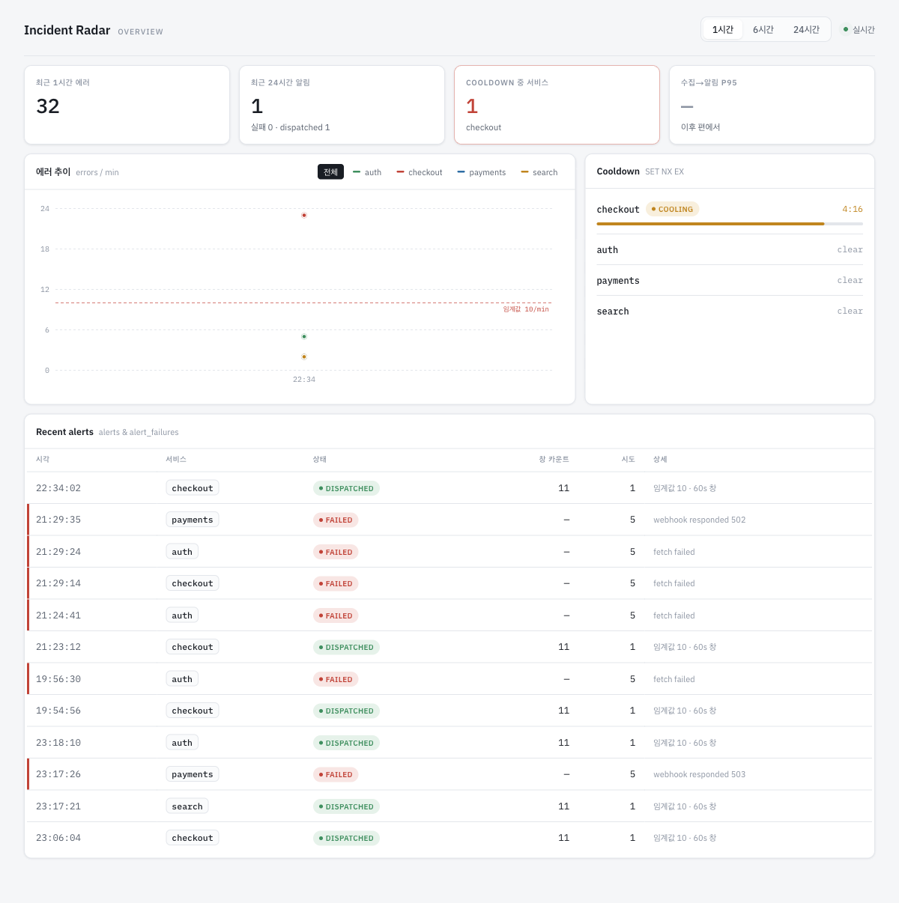

지금까지 `docker-compose.yml`은 postgres·redis만 관리했고, backend·frontend는 로컬에서 `pnpm dev`로 직접 실행했습니다.

이번 편에서는 backend·frontend도 컨테이너로 옮깁니다. 모노레포를 이미지로 빌드하고, postgres·redis가 정상 상태가 된 뒤 backend가 마이그레이션을 실행하고 기동되며, frontend는 API 주소를 빌드 타임에 고정한 채 기동됩니다.

## 모노레포를 하나의 빌드 컨텍스트로 쓴다

Dockerfile은 이미지를 어떻게 만들지 정의하고, compose는 그 이미지를 어떻게 실행할지 정의합니다.

```
Dockerfile --(docker build)--> 이미지 --(docker compose up)--> 컨테이너
```

| 단계 | 하는 일 |
|---|---|
| Dockerfile | 베이스 이미지·설치·빌드·기동 명령을 정의하는 설계도 |
| 이미지 (`docker build`) | Dockerfile대로 만들어진, 아직 실행 전인 배포 단위 |
| 컨테이너 (`docker compose up`) | 이미지를 실제로 띄운 상태. 포트·환경변수·기동 순서는 compose가 지정 |

backend 이미지를 만들려면 `apps/backend` 코드뿐 아니라 워크스페이스 루트의 `pnpm-lock.yaml`과 `packages/shared`도 함께 있어야 `pnpm install`이 제대로 됩니다. 그래서 빌드 컨텍스트를 앱 디렉터리가 아니라 레포 루트로 잡았습니다.

```yaml
# docker-compose.yml (일부)
backend:
  build:
    context: .
    dockerfile: apps/backend/Dockerfile
```

Dockerfile 안에서는 전체를 빌드하지 않고, `turbo`의 필터로 backend와 그 의존 패키지(`shared`)만 빌드합니다.

```dockerfile
# apps/backend/Dockerfile (일부)
WORKDIR /app
COPY . .
RUN pnpm install --frozen-lockfile
RUN pnpm exec turbo run build --filter=@incident-radar/backend...
```

`--filter=@incident-radar/backend...`의 `...`는 이 패키지가 의존하는 패키지까지 포함하라는 뜻입니다. `@incident-radar/shared`가 먼저 빌드된 뒤 backend가 빌드됩니다. frontend Dockerfile도 필터 대상만 다르고 구조는 같습니다.

## 기동 순서와 마이그레이션

backend는 postgres·redis가 준비되기 전엔 뜰 이유가 없습니다. `depends_on`에 `condition: service_healthy`를 지정해서, 두 서비스의 헬스체크가 통과할 때까지 backend 컨테이너 생성을 미룹니다.

```yaml
# docker-compose.yml (일부)
depends_on:
  postgres:
    condition: service_healthy
  redis:
    condition: service_healthy
```

DB가 준비된 뒤에도 스키마가 최신이라는 보장은 없습니다. 컨테이너가 뜰 때마다 마이그레이션을 먼저 실행하고, 그다음 앱을 기동하도록 엔트리포인트를 구성했습니다.

```dockerfile
# apps/backend/Dockerfile (일부)
CMD ["sh", "-c", "pnpm migration:run && node dist/main.js"]
```

이미 적용된 마이그레이션과 아직 안 된 것을 구분하는 건 TypeORM의 `migrations` 테이블이 맡고 있어서, 이미 적용된 상태로 다시 떠도 `No migrations are pending`으로 끝나고 앱이 기동됩니다.

## 컨테이너 안에서는 환경변수가 달라진다

이 섹션에서는 컨테이너를 띄운 뒤(런타임)에 덮어쓰는 값과, 이미지를 빌드할 때 아예 고정해버리는 값을 다룹니다.

`.env`는 로컬 개발 환경 기준으로 적혀 있어서, 컨테이너 안에서 그대로 쓰면 두 가지가 어긋납니다. 먼저 `DATABASE_URL`·`REDIS_URL`은 호스트 기준 `localhost`를 가리키는데, 컨테이너 안에서는 `localhost`가 자기 자신을 가리키므로 compose의 서비스명(`postgres`·`redis`)으로 덮어써야 합니다.

```yaml
# docker-compose.yml (일부)
environment:
  DATABASE_URL: postgres://ir:ir@postgres:5432/incident_radar
  REDIS_URL: redis://redis:6379
```

`NODE_ENV=development`도 마찬가지로 어긋납니다. 처음 기동했을 때 frontend 로그에 "non-standard NODE_ENV" 경고가 떴는데, `next start`가 이 값을 그대로 받아서 프로덕션 최적화 없이 뜬 것이었습니다.

같은 변수가 여러 곳에 정의돼 있으면, compose는 다음 순서로 우선순위를 매깁니다.

```
environment(compose) > env_file(compose) > ENV(Dockerfile)
```

`environment`가 가장 위이므로, 여기에 `NODE_ENV: production`을 명시하면 `env_file`(`.env`)의 `development` 값을 덮어씁니다.

여기까지는 컨테이너를 띄운 뒤에도 바꿀 수 있는 값입니다. `NEXT_PUBLIC_API_URL`은 다릅니다. Next.js는 `NEXT_PUBLIC_` 접두사가 붙은 환경변수를 빌드할 때 브라우저 번들에 그대로 박아 넣기 때문에, 컨테이너를 띄운 뒤 값을 바꿔도 반영되지 않습니다. 그래서 이미지를 빌드하는 시점에 build arg로 넘겨서 고정했습니다.

```dockerfile
# apps/frontend/Dockerfile (일부)
ARG NEXT_PUBLIC_API_URL
ENV NEXT_PUBLIC_API_URL=$NEXT_PUBLIC_API_URL
```

이 값은 브라우저가 직접 호출하는 주소라, 컨테이너 내부 서비스명(`backend`)이 아니라 호스트에 매핑된 포트(`localhost:3000`)를 넘겼습니다.

## 검증

클린 상태에서 `docker compose up --build`로 postgres·redis·backend·frontend를 한 번에 띄웠습니다.

```text
$ docker compose ps --format "table {{.Service}}\t{{.Status}}\t{{.Ports}}"
SERVICE    STATUS                PORTS
backend    Up 11 seconds         0.0.0.0:3000->3000/tcp
frontend   Up 11 seconds         0.0.0.0:3001->3001/tcp
postgres   Up 2 days (healthy)   0.0.0.0:5432->5432/tcp
redis      Up 2 days (healthy)   0.0.0.0:6379->6379/tcp
```

그다음 호스트에서 `simulator --spike checkout`으로 트래픽을 흘렸습니다. checkout 임계값 초과 알림이 dispatched로 기록되고, cooldown이 걸리고, 차트에 스파이크가 반영되는 것까지 대시보드에서 확인했습니다.


