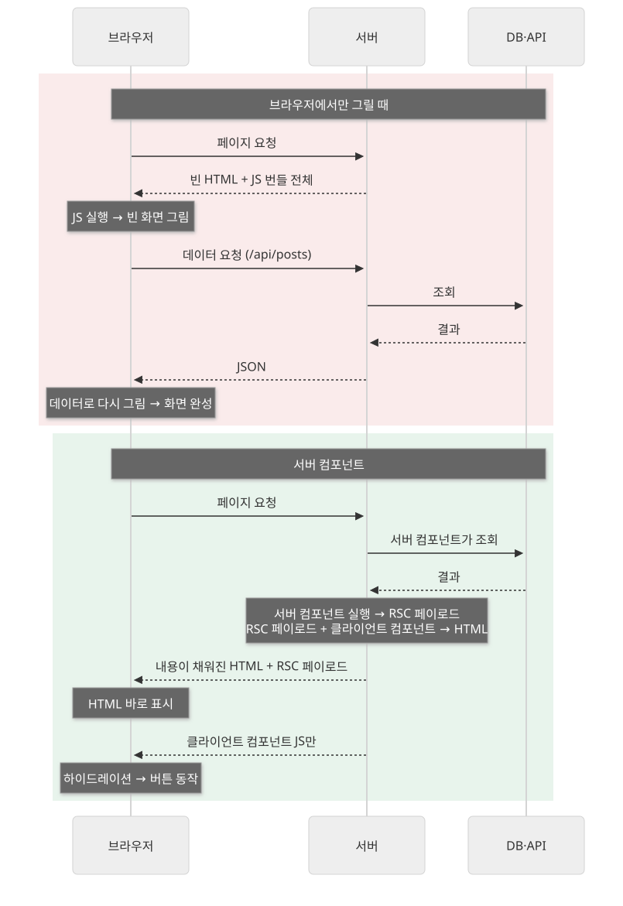

Next.js App Router에서는 컴포넌트를 서버 컴포넌트와 클라이언트 컴포넌트로 나눠 씁니다.

모든 컴포넌트를 브라우저에서 그릴 때 무엇이 불편한지 보고, 두 컴포넌트가 각각 어디서 실행되는지, 첫 화면이 그려지는 순서, 두 컴포넌트를 함께 쓰는 방법을 살펴봅니다. 서버 컴포넌트가 데이터와 HTML을 준비하고, 클릭이나 입력처럼 사용자와 주고받는 부분만 클라이언트 컴포넌트가 브라우저에서 맡습니다.

## 모든 컴포넌트를 브라우저에서 그릴 때의 문제

React 앱을 브라우저에서만 그리면, 사용자가 화면을 보기까지 다음 과정을 거칩니다.

1. 비어 있는 HTML과 JavaScript 번들을 내려받습니다.
2. JavaScript를 실행해 화면을 그립니다.
3. 컴포넌트가 API에 데이터를 요청하고, 응답이 오면 다시 그립니다.

이 방식에는 다음 문제가 있습니다.

- **JavaScript가 많아집니다.** 글 목록처럼 한 번 보여주기만 하는 화면도 그리는 코드 전체를 브라우저가 받아 실행해야 합니다.
- **데이터를 늦게 받습니다.** JavaScript를 실행한 뒤에야 데이터 요청을 시작하므로, 서버와 한 번 더 주고받는 시간만큼 화면이 늦게 채워집니다.
- **비밀값을 둘 수 없습니다.** 브라우저로 보낸 코드는 누구나 볼 수 있으므로 DB 접속 정보나 API 키를 넣을 수 없고, 이를 대신 쓰는 API 서버를 따로 둬야 합니다.

## 서버 컴포넌트란

**서버 컴포넌트**는 서버에서만 실행되는 React 컴포넌트입니다. App Router에서 `page.tsx`, `layout.tsx`는 기본으로 서버 컴포넌트이고, 여기서 import한 컴포넌트도 `'use client'`를 적지 않았다면 서버 컴포넌트입니다.

서버에서 실행되므로 컴포넌트 안에서 바로 데이터를 읽을 수 있습니다. 함수에 `async`를 붙이고 `await`로 DB나 API 결과를 기다린 뒤 그립니다.

```tsx
// app/posts/page.tsx
import { db } from '@/lib/db';

export default async function PostsPage() {
  const posts = await db.post.findMany();
  return (
    <ul>
      {posts.map((post) => <li key={post.id}>{post.title}</li>)}
    </ul>
  );
}
```

서버 컴포넌트의 코드는 브라우저로 보내는 JavaScript 번들에 들어가지 않습니다. 브라우저는 서버가 그린 결과만 받습니다. 그래서 위 코드의 `db` 접속 정보도 브라우저에 노출되지 않습니다.

대신 브라우저에서만 할 수 있는 일은 하지 못합니다. `useState`, `useEffect` 같은 훅, `onClick` 같은 이벤트 처리, `window`·`localStorage` 같은 브라우저 API를 쓸 수 없습니다.

## 클라이언트 컴포넌트란

**클라이언트 컴포넌트**는 브라우저에서 동작하는 컴포넌트입니다. 파일 맨 위, import보다 앞에 `'use client'`를 적어 표시합니다.

```tsx
// app/counter.tsx
'use client';
import { useState } from 'react';

export function Counter({ initial }: { initial: number }) {
  const [count, setCount] = useState(initial);
  return <button onClick={() => setCount(count + 1)}>{count}</button>;
}
```

`'use client'` 없이 `useState`를 쓰면 빌드할 때 다음 오류가 납니다.

```text
Error: You're importing a module that depends on `useState` into a React Server Component module. This API is only available in Client Components. To fix, mark the file (or its parent) with the `"use client"` directive.
```

이름과 달리 클라이언트 컴포넌트도 첫 화면의 HTML은 서버에서 미리 그립니다. 위 `Counter`를 넣은 페이지를 요청하면, 서버 로그에 `Counter`가 그려진 기록이 남고 응답 HTML의 `<button>` 안에 `2`가 이미 들어 있습니다. 브라우저는 이 HTML을 먼저 보여준 뒤, `Counter`의 JavaScript를 받아 버튼에 클릭 처리를 연결합니다.

`'use client'`는 그 파일 하나만 표시하는 것이 아니라 경계를 만듭니다. 그 파일이 import하는 모듈과 직접 그리는 컴포넌트도 모두 브라우저 번들에 들어갑니다. 그래서 화면 대부분이 정적인 레이아웃에 검색창 하나만 상호작용이 필요하다면, 레이아웃 전체가 아니라 검색창 컴포넌트에만 `'use client'`를 붙입니다. 레이아웃은 서버 컴포넌트로 남아 번들에 들어가지 않습니다.

> 💡 **여기까지 정리하면**
>
> - App Router의 컴포넌트는 기본으로 서버 컴포넌트입니다. 서버에서만 실행되고, 코드가 브라우저 번들에 들어가지 않습니다.
> - 서버 컴포넌트는 `async`로 DB나 API를 바로 읽을 수 있지만, 훅·이벤트·브라우저 API는 쓰지 못합니다.
> - 파일 맨 위에 `'use client'`를 적으면 클라이언트 컴포넌트가 됩니다. 첫 HTML은 서버에서 그리고, 동작은 브라우저에서 합니다.
> - `'use client'` 파일이 import하는 모듈도 모두 브라우저 번들에 들어갑니다.

## 첫 화면이 그려지는 순서

페이지를 처음 열면 서버와 브라우저가 다음 순서로 일합니다.

1. 서버가 서버 컴포넌트를 실행해 **RSC 페이로드**(React Server Component Payload)를 만듭니다. 서버 컴포넌트가 그린 결과, 클라이언트 컴포넌트가 들어갈 자리와 그 JavaScript 파일 위치, 클라이언트 컴포넌트에 넘길 props가 담긴 데이터입니다.
2. 서버가 RSC 페이로드와 클라이언트 컴포넌트로 HTML을 미리 그려 보냅니다.
3. 브라우저는 HTML을 바로 보여줍니다. 이때는 화면만 보이고 버튼은 아직 동작하지 않습니다.
4. 브라우저가 클라이언트 컴포넌트의 JavaScript를 받아 실행하고, 이미 그려진 HTML에 이벤트 처리를 연결합니다. 이 과정을 **하이드레이션(hydration)** 이라고 합니다.



첫 화면 이후 다른 페이지로 이동할 때는 HTML 대신 RSC 페이로드만 받아 화면을 바꿉니다.

## 두 컴포넌트를 함께 쓰는 방법

### 서버에서 클라이언트로 props 넘기기

서버 컴포넌트는 클라이언트 컴포넌트를 import해 그리고, 읽은 데이터를 props로 넘길 수 있습니다.

```tsx
// app/page.tsx (서버 컴포넌트)
import { Counter } from './counter';

export default async function Page() {
  const posts = await getPosts();
  return <Counter initial={posts.length} />;
}
```

props는 RSC 페이로드에 담겨 서버에서 브라우저로 전달되므로, 문자열·숫자·배열·일반 객체처럼 데이터로 바꿀 수 있는 값이어야 합니다. 일반 함수는 넘길 수 없습니다(`'use server'`로 표시한 서버 함수는 예외입니다). `onDone={() => ...}`처럼 함수를 넘기면 서버에서 페이지를 그릴 때 다음 오류가 납니다.

```text
Error: Event handlers cannot be passed to Client Component props.
  {initial: 2, onDone: function onDone}
```

### children으로 서버 컴포넌트 넣기

클라이언트 컴포넌트 안에 서버에서 그린 내용을 넣고 싶을 때는 `children`으로 넘깁니다. 열고 닫는 상태는 클라이언트 컴포넌트가 갖고, 안의 내용은 서버 컴포넌트가 그립니다.

```tsx
// app/panel.tsx
'use client';
import { useState } from 'react';

export function Panel({ children }: { children: React.ReactNode }) {
  const [open, setOpen] = useState(true);
  return (
    <section>
      <button onClick={() => setOpen(!open)}>접기</button>
      {open && children}
    </section>
  );
}
```

```tsx
// app/page.tsx (서버 컴포넌트)
import { Panel } from './panel';
import { Cart } from './cart'; // 서버에서 데이터를 읽는 서버 컴포넌트

export default function Page() {
  return (
    <Panel>
      <Cart />
    </Panel>
  );
}
```

`Cart`는 `Panel`이 import한 것이 아니라 서버 컴포넌트인 `Page`가 넘긴 것이므로 서버 컴포넌트로 남습니다. 서버가 `Cart`를 먼저 그리고, 그 결과가 `Panel`의 `children` 자리에 들어갑니다.



## 언제 어느 쪽을 쓸까?

서버 컴포넌트가 맞는 경우입니다.

- **데이터를 읽어 보여주는 화면** — DB나 API를 서버에서 바로 읽고, 결과만 보냅니다.
- **비밀값을 쓰는 코드** — API 키나 토큰이 브라우저 번들에 들어가지 않습니다.
- **상호작용이 없는 부분** — 제목, 본문, 목록처럼 보여주기만 하는 부분은 번들 크기를 늘리지 않습니다.

클라이언트 컴포넌트가 맞는 경우입니다.

- **상태와 이벤트** — `useState`, `onClick`, `onChange`가 필요한 입력창, 버튼, 토글.
- **화면이 그려진 뒤 실행할 코드** — `useEffect`로 구독하거나 타이머를 거는 코드.
- **브라우저 API** — `localStorage`, `window`, 위치 정보.
- **훅이나 Context를 쓰는 라이브러리** — React Context는 서버 컴포넌트에서 쓸 수 없으므로, Context를 제공하는 컴포넌트도 클라이언트 컴포넌트로 만듭니다.

## 정리

- App Router의 컴포넌트는 기본으로 서버 컴포넌트입니다. 서버에서 데이터를 읽어 그리고, 코드가 브라우저 번들에 들어가지 않지만, 훅·이벤트·브라우저 API는 쓰지 못합니다.
- `'use client'`를 적은 파일은 클라이언트 컴포넌트가 됩니다. 첫 HTML은 서버에서 그리고, 브라우저에서 하이드레이션을 거쳐 동작합니다.
- 서버 컴포넌트는 클라이언트 컴포넌트에 데이터로 바꿀 수 있는 props를 넘기고, `children`으로 서버에서 그린 내용을 넣을 수 있습니다.
- `'use client'` 아래 import는 모두 브라우저 번들에 들어가므로, 상호작용이 필요한 부분만 작게 떼어 클라이언트 컴포넌트로 만듭니다.
