Next.js App Router는 `app` 폴더 안의 폴더 구조가 그대로 URL이 되는 파일 기반 라우팅을 씁니다.

라우터 설정 코드로 URL을 정할 때 무엇이 불편한지 보고, 폴더와 `page` 파일로 URL을 만드는 규칙, 레이아웃이 페이지를 감싸는 방식, 동적 라우트, 로딩·오류·404 화면을 맡는 특수 파일을 살펴봅니다. 폴더가 URL 경로를 정하고, 그 폴더 안의 파일 이름이 그 경로에서 어떤 화면을 맡을지 정합니다.

## 라우터 설정 파일로 URL을 관리할 때의 문제

React만 쓰는 앱에서는 보통 라우터 라이브러리에 경로와 컴포넌트를 짝지어 등록합니다.

```tsx
<Routes>
  <Route path="/" element={<Home />} />
  <Route path="/blog" element={<BlogLayout />}>
    <Route index element={<BlogList />} />
    <Route path=":slug" element={<BlogPost />} />
  </Route>
</Routes>
```

이 방식에는 다음 문제가 있습니다.

- **경로와 파일 위치가 따로 놉니다.** `/blog/:slug` 화면의 코드가 어느 파일에 있는지 설정을 열어 봐야 압니다.
- **화면 수만큼 설정이 길어집니다.** 페이지를 추가할 때마다 설정 파일도 함께 고쳐야 합니다.
- **로딩·오류 화면을 직접 연결합니다.** 경로마다 로딩 표시와 오류 처리를 어디에 둘지 직접 감싸야 합니다.

## 폴더와 page 파일로 URL 만들기

App Router에서는 `app` 폴더 안의 **폴더 하나가 URL 경로 한 칸**(세그먼트)이 됩니다. 폴더 안에 `page.tsx`가 있어야 그 경로가 실제로 열립니다.

```text
app/
├── page.tsx                  → /
├── blog/
│   ├── page.tsx              → /blog
│   ├── [slug]/page.tsx       → /blog/hello, /blog/world …
│   └── _components/title.tsx → URL 없음 (404)
└── (shop)/
    └── cart/page.tsx         → /cart  ((shop)은 URL에서 빠짐)
```

`page.tsx`는 그 경로에서 보여줄 컴포넌트를 `export default`로 내보냅니다.

```tsx
// app/blog/page.tsx → /blog
export default function BlogPage() {
  return <h1>블로그</h1>;
}
```

`page.tsx`가 없는 폴더는 URL이 생기지 않습니다. 그래서 컴포넌트나 유틸 파일을 경로 폴더 안에 같이 둬도 주소로 열리지 않고, 브라우저로 보내지는 것은 `page.tsx`가 돌려준 화면뿐입니다.

폴더 이름에 특별한 표시를 붙이면 URL에 미치는 영향이 달라집니다.

| 폴더 이름 | 뜻 | 예 |
|---|---|---|
| `blog` | URL 경로 한 칸 | `app/blog/page.tsx` → `/blog` |
| `(shop)` | 라우트 그룹. URL에 포함되지 않음 | `app/(shop)/cart/page.tsx` → `/cart` |
| `_components` | 비공개 폴더. 그 아래 전체가 라우팅에서 빠짐 | `app/blog/_components/title.tsx` → 404 |

**라우트 그룹**은 URL을 바꾸지 않고 폴더를 묶을 때 씁니다. `(shop)` 아래 페이지들만 같은 레이아웃을 쓰게 하거나, 관련 페이지를 한곳에 모아 둘 때 유용합니다.

## 레이아웃으로 공통 화면 감싸기

**레이아웃**(`layout.tsx`)은 여러 페이지가 함께 쓰는 화면입니다. 헤더, 사이드바, 내비게이션처럼 페이지가 바뀌어도 남아 있어야 하는 부분을 둡니다. 레이아웃은 `children`을 받아, 그 자리에 페이지나 하위 레이아웃을 넣습니다.

```tsx
// app/layout.tsx (루트 레이아웃)
export default function RootLayout({ children }: { children: React.ReactNode }) {
  return (
    <html lang="ko">
      <body>
        <header>사이트 헤더</header>
        {children}
      </body>
    </html>
  );
}
```

`app` 바로 아래의 레이아웃을 **루트 레이아웃**이라고 하고, 반드시 있어야 합니다. `<html>`과 `<body>` 태그도 여기서 그립니다.

레이아웃은 폴더 구조를 따라 겹칩니다. `app/blog/layout.tsx`를 추가하면 `/blog`와 그 아래 모든 경로에서 루트 레이아웃 → 블로그 레이아웃 → 페이지 순서로 감쌉니다. 실제로 `/blog/hello`를 요청하면 응답 HTML에 루트 레이아웃의 헤더, 블로그 레이아웃의 내비게이션, 글 내용이 이 순서로 들어 있습니다.

다른 페이지로 이동해도 공통 레이아웃은 다시 그려지지 않고 상태를 유지합니다. 예를 들어 `/blog/hello`에서 `/blog/world`로 가면 블로그 레이아웃의 내비게이션은 그대로 두고 페이지 부분만 바뀝니다.

페이지 사이를 이동할 때는 `<a>` 대신 `next/link`의 `<Link>`를 씁니다. 화면에 보이는 링크의 페이지를 미리 받아 두고(prefetch), 클릭하면 페이지 전체를 새로 받지 않고 바뀐 부분만 교체합니다.

```tsx
import Link from 'next/link';

<Link href="/blog/hello">첫 글</Link>
```

> 💡 **여기까지 정리하면**
>
> - `app` 안의 폴더 하나가 URL 경로 한 칸이고, `page.tsx`가 있어야 그 경로가 열립니다.
> - `(그룹)` 폴더는 URL에서 빠지고, `_폴더`는 라우팅에서 통째로 빠집니다.
> - `layout.tsx`는 같은 폴더와 그 아래 모든 페이지를 감싸고, 이동해도 다시 그려지지 않습니다.

## 동적 라우트

글 주소처럼 값에 따라 바뀌는 경로는 폴더 이름을 대괄호로 감싸 만듭니다. `app/blog/[slug]/page.tsx` 하나가 `/blog/hello`, `/blog/world`를 모두 맡습니다.

URL의 값은 `params`로 받습니다. Next.js 16에서 `params`는 Promise이므로 `await`로 꺼냅니다.

```tsx
// app/blog/[slug]/page.tsx
import { notFound } from 'next/navigation';

export default async function PostPage({ params }: { params: Promise<{ slug: string }> }) {
  const { slug } = await params;
  const post = await getPost(slug);
  if (!post) notFound();
  return <article>{post.title}</article>;
}
```

대괄호 안에 `...`을 붙이면 여러 칸을 한 번에 받습니다.

| 폴더 이름 | 맞는 URL | `params` |
|---|---|---|
| `[slug]` | `/blog/hello` | `{ slug: 'hello' }` |
| `[...slug]` | `/shop/a`, `/shop/a/b` | `{ slug: ['a', 'b'] }` |
| `[[...slug]]` | `/docs`, `/docs/a/b` | `{ slug: undefined }`, `{ slug: ['a', 'b'] }` |

`[[...slug]]`처럼 대괄호를 두 겹으로 쓰면 값이 하나도 없는 `/docs`도 같은 페이지가 맡습니다.

빌드할 때 미리 만들어 둘 값은 `generateStaticParams`로 알려줍니다. 여기서 돌려준 값의 페이지는 빌드 때 HTML로 만들어지고, 목록에 없는 값은 요청이 왔을 때 그립니다.

```tsx
export function generateStaticParams() {
  return [{ slug: 'hello' }, { slug: 'world' }];
}
```

## 로딩·오류·404 화면을 맡는 특수 파일

`page`, `layout` 말고도 정해진 이름의 파일을 폴더에 두면 Next.js가 그 경로에 자동으로 연결합니다.

| 파일 | 역할 |
|---|---|
| `loading.tsx` | 페이지를 그리는 동안 먼저 보여줄 로딩 화면 |
| `error.tsx` | 그리다가 예상하지 못한 오류가 났을 때 보여줄 화면 |
| `not-found.tsx` | `notFound()`를 불렀을 때 보여줄 404 화면 |
| `route.ts` | 화면 대신 HTTP 응답을 돌려주는 API 엔드포인트 |

같은 폴더에 있는 파일들은 다음 순서로 겹쳐 그려집니다. 바깥 파일이 안쪽을 감쌉니다.



이 순서 때문에 `page`에서 오류가 나면 바로 바깥의 `error.tsx`가 받고, 레이아웃은 그대로 남습니다. `error.tsx`는 오류가 난 구간 대신 그려지고, 다시 시도할 수 있게 `retry` 함수를 받습니다. `retry`는 그 구간의 데이터를 다시 가져와 다시 그립니다. 오류 화면은 브라우저에서 동작해야 하므로 `'use client'`를 붙입니다.

```tsx
// app/blog/error.tsx
'use client';

export default function Error({ retry }: { error: unknown; retry: () => void }) {
  return (
    <div>
      <p>글을 불러오지 못했습니다.</p>
      <button onClick={() => retry()}>다시 시도</button>
    </div>
  );
}
```

`error.tsx`가 없으면 오류는 상위 폴더로 올라가 가장 가까운 `error.tsx`가 받습니다. 경로마다 오류 화면을 다르게 두거나, 상위 폴더에 하나만 두고 함께 쓸 수 있습니다.

`notFound()`는 "값은 받았지만 그런 글이 없다" 같은 상황에 부릅니다. 위 동적 라우트 예제에서 없는 slug가 오면 같은 폴더의 `not-found.tsx`가 그려집니다.

## 언제 어떤 파일을 쓸까?

- **새 주소가 필요할 때** — 폴더를 만들고 `page.tsx`를 둡니다.
- **여러 페이지가 같은 틀을 쓸 때** — 공통 부분을 그 폴더의 `layout.tsx`로 올립니다. URL을 바꾸지 않고 일부 페이지만 묶으려면 `(그룹)` 폴더 안에 레이아웃을 둡니다.
- **주소 안의 값으로 화면이 바뀔 때** — `[slug]` 폴더와 `params`를 씁니다. 미리 알 수 있는 값은 `generateStaticParams`로 빌드 때 만듭니다.
- **데이터를 기다리는 페이지** — `loading.tsx`로 기다리는 동안의 화면을 둡니다.
- **실패할 수 있는 페이지** — `error.tsx`로 오류 화면을, `not-found.tsx`로 없는 데이터 화면을 둡니다.
- **경로 폴더 안에 둘 보조 코드** — 그냥 둬도 URL이 생기지 않지만, 구분을 위해 `_components`처럼 `_` 폴더에 모읍니다.

## 정리

- App Router는 `app` 폴더의 구조가 URL이 됩니다. 폴더 하나가 경로 한 칸이고, `page.tsx`가 있어야 그 경로가 열립니다.
- `layout.tsx`는 같은 폴더와 하위 경로의 페이지를 감싸고, 페이지를 이동해도 다시 그려지지 않습니다.
- `[slug]`, `[...slug]`, `[[...slug]]` 폴더로 값이 바뀌는 경로를 만들고, 값은 `await params`로 꺼냅니다.
- `loading`, `error`, `not-found` 파일은 정해진 순서로 페이지를 감싸, 로딩·오류·404 화면을 경로별로 맡습니다.
