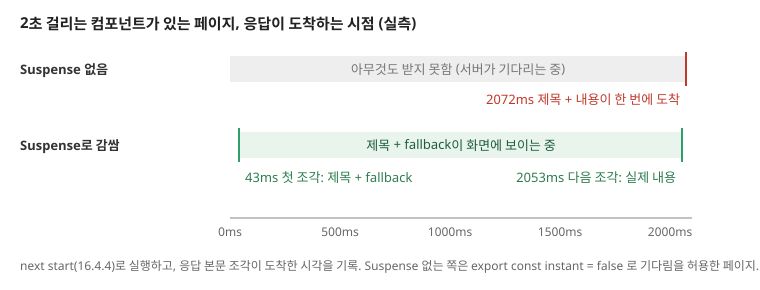

Next.js에서는 서버 컴포넌트가 데이터를 직접 가져와 화면을 그리고, 느린 부분은 스트리밍으로 나중에 채워 보냅니다.

데이터를 모두 기다린 뒤 페이지를 보낼 때 무엇이 불편한지 보고, 서버 컴포넌트에서 데이터를 가져오는 방법, `<Suspense>`와 `loading.tsx`로 스트리밍하는 방법, Cache Components 설정에서 `<Suspense>`가 필요한 이유를 살펴봅니다. 서버는 바로 그릴 수 있는 부분과 로딩 화면을 먼저 보내고, 데이터가 준비된 부분을 같은 응답에 이어서 보냅니다.

## 데이터를 모두 기다린 뒤 보낼 때의 문제

서버 컴포넌트는 요청이 오면 서버에서 데이터를 가져와 그립니다. 그런데 한 페이지 안에 느린 요청이 하나라도 있으면, 그 요청이 끝날 때까지 페이지 전체가 기다립니다.

```tsx
export default async function Dashboard() {
  const user = await getUser(); // 50ms
  const report = await getReport(); // 2초
  return (
    <main>
      <h1>{user.name}님의 대시보드</h1>
      <Report data={report} />
    </main>
  );
}
```

- **빠른 부분도 늦게 보입니다.** 제목은 50ms면 그릴 수 있지만, 보고서를 기다리느라 사용자는 2초 동안 빈 화면을 봅니다.
- **느린 요청 하나가 전체를 막습니다.** 데이터가 많은 페이지일수록 가장 느린 요청이 페이지가 뜨는 시간을 정합니다.

## 서버 컴포넌트에서 데이터 가져오기

서버 컴포넌트는 함수에 `async`를 붙이고 `await`로 데이터를 기다립니다. `fetch`로 외부 API를 부르거나, ORM으로 DB를 바로 조회해도 됩니다. 서버에서만 실행되므로 DB 접속 정보와 쿼리 코드는 브라우저 번들에 들어가지 않습니다.

```tsx
export default async function PostsPage() {
  const res = await fetch('https://api.example.com/posts');
  const posts = await res.json();
  return <ul>{posts.map((p) => <li key={p.id}>{p.title}</li>)}</ul>;
}
```

같은 렌더링 안에서 같은 주소로 보낸 `fetch`는 한 번만 실행되고 결과를 함께 씁니다. 그래서 데이터를 부모에서 받아 props로 내리지 않고, 필요한 컴포넌트에서 각자 `fetch`해도 요청이 늘지 않습니다. `fetch`가 아닌 DB 조회 함수는 React의 `cache`로 감싸면 같은 요청 안에서 결과를 함께 씁니다.

```ts
import { cache } from 'react';

export const getUser = cache(async (id: string) => {
  return db.user.findUnique({ where: { id } });
});
```

서로 기다릴 필요가 없는 요청은 `Promise.all`로 동시에 시작합니다. `await`를 하나씩 이어 쓰면 앞 요청이 끝나야 다음 요청이 시작됩니다.

```tsx
const [user, report] = await Promise.all([getUser(), getReport()]);
```

## 스트리밍

**스트리밍**은 페이지를 조각으로 나눠, 준비된 조각부터 브라우저로 보내는 방식입니다. 응답은 하나지만, 서버는 응답을 끝내지 않고 조각을 이어서 보냅니다.

어디까지 먼저 보낼지는 `<Suspense>`로 정합니다. `<Suspense>` 밖은 바로 보내고, 안쪽은 `fallback`을 먼저 보낸 뒤 데이터가 준비되면 실제 내용으로 바꿉니다.

```tsx
import { Suspense } from 'react';

export default function Dashboard() {
  return (
    <main>
      <h1>대시보드</h1>
      <Suspense fallback={<p>보고서를 불러오는 중</p>}>
        <Report />
      </Suspense>
    </main>
  );
}

async function Report() {
  const report = await getReport(); // 2초
  return <ReportTable data={report} />;
}
```

2초 걸리는 컴포넌트가 있는 페이지에서, `<Suspense>`로 감쌌을 때와 감싸지 않았을 때 응답이 도착하는 시점을 재면 다음과 같습니다.



제목과 "불러오는 중"은 43ms에 이미 화면에 그려지고, 보고서는 2초 뒤에 같은 자리를 채웁니다. 느린 컴포넌트를 여러 `<Suspense>`로 나눠 감싸면 각자 준비되는 대로 따로 채워집니다.

### loading.tsx로 페이지 전체 감싸기

폴더에 `loading.tsx`를 두면 그 폴더의 `page.tsx`를 `<Suspense>`로 감싼 것과 같습니다. `loading.tsx`가 돌려준 화면이 `fallback`이 됩니다.

```tsx
// app/dashboard/loading.tsx
export default function Loading() {
  return <p>대시보드를 불러오는 중</p>;
}
```

페이지를 이동하면 레이아웃과 로딩 화면이 바로 보이고, 페이지가 다 그려지면 로딩 화면이 페이지로 바뀝니다.

`loading.tsx`는 같은 폴더의 `layout.tsx` 안쪽에 들어가므로, 레이아웃 자체는 감싸지 않습니다. 레이아웃에서 느린 데이터를 읽으면 로딩 화면 없이 그 데이터를 기다립니다. 이럴 때는 데이터를 읽는 부분을 `page.tsx`로 옮기거나, 레이아웃 안에서 그 부분만 `<Suspense>`로 따로 감쌉니다.

`loading.tsx`는 페이지 전체를 한 번에 기다리고, `<Suspense>`는 원하는 부분만 감쌉니다. 페이지에서 일부만 느리다면 그 부분 가까이에 `<Suspense>`를 두는 편이 더 많은 내용을 먼저 보여줍니다.

> 💡 **여기까지 정리하면**
>
> - 서버 컴포넌트는 `async`/`await`로 `fetch`나 DB를 바로 읽고, 같은 `fetch`는 한 렌더링 안에서 한 번만 실행됩니다.
> - 스트리밍은 준비된 조각부터 보내는 방식이고, `<Suspense>` 밖은 바로, 안쪽은 `fallback` 뒤에 채워집니다.
> - `loading.tsx`는 같은 폴더의 `page.tsx`를 `<Suspense>`로 감싸지만, 레이아웃은 감싸지 않습니다.

## Cache Components에서 Suspense가 필요한 이유

Next.js 16.4의 `create-next-app`으로 만든 프로젝트는 `next.config.ts`에 `cacheComponents: true`가 켜져 있습니다. 이 설정에서 Next.js는 빌드할 때 각 페이지를 미리 그려 둘 수 있는 데까지 그립니다. 그러다 다음 값을 읽는 컴포넌트를 만나면 거기서 멈춥니다.

- 캐시하지 않은 `fetch`나 DB 조회처럼 요청 때마다 결과가 달라질 수 있는 데이터
- `cookies()`, `headers()`, `searchParams`처럼 요청이 와야 알 수 있는 값

이런 컴포넌트는 `<Suspense>` 안에 있어야 합니다. 그래야 Next.js가 그 자리를 `fallback`으로 채워 두고 나머지를 미리 그릴 수 있습니다. 감싸지 않으면 빌드할 때 다음 오류가 납니다.

```text
Error: Route "/": Next.js encountered uncached or runtime data during prerendering.

`fetch(...)`, `cookies()`, `headers()`, `params`, `searchParams`, or `connection()` accessed outside of `<Suspense>` prevents the route from being prerendered, blocking the page load and leading to a slower user experience.
```

오류 메시지가 알려주는 해결 방법은 세 가지입니다.

- **`<Suspense>`로 감싸기** — 요청 때마다 새로 읽어야 하는 데이터라면 감싸서 스트리밍합니다.
- **`'use cache'`로 캐시하기** — 모든 사용자가 같은 결과를 봐도 되는 데이터라면 캐시해서 미리 그려 둡니다.
- **`export const instant = false`** — 페이지 전체가 데이터를 기다리도록 허용합니다.

외부 데이터를 읽지 않지만 요청 때마다 다시 실행해야 하는 컴포넌트는 `connection()`을 먼저 `await`해서 표시합니다. `Date.now()`나 `Math.random()`으로 요청마다 다른 값을 만들 때 씁니다.

```tsx
import { connection } from 'next/server';

async function RequestTime() {
  await connection();
  return <p>{new Date().toISOString()}</p>;
}
```

## 클라이언트 컴포넌트에 데이터 넘기기

클라이언트 컴포넌트에서 쓸 데이터는 서버 컴포넌트가 가져와 props로 넘기는 것이 기본입니다. 데이터를 기다리지 않고 바로 넘기고 싶다면 Promise를 그대로 넘기고, 클라이언트 컴포넌트에서 React의 `use`로 꺼냅니다.

```tsx
// app/page.tsx (서버 컴포넌트)
export default function Page() {
  const posts = getPosts(); // await하지 않음
  return (
    <Suspense fallback={<p>불러오는 중</p>}>
      <Posts posts={posts} />
    </Suspense>
  );
}
```

```tsx
// app/posts.tsx
'use client';
import { use } from 'react';

export function Posts({ posts }: { posts: Promise<Post[]> }) {
  const list = use(posts);
  return <ul>{list.map((p) => <li key={p.id}>{p.title}</li>)}</ul>;
}
```

브라우저에서 사용자 동작에 따라 데이터를 다시 가져와야 한다면 TanStack Query나 SWR 같은 데이터 패칭 라이브러리를 씁니다.

## 언제 무엇을 쓸까?

- **페이지를 그리는 데 필요한 데이터** — 서버 컴포넌트에서 `async`/`await`로 읽습니다.
- **일부만 느린 페이지** — 느린 컴포넌트만 `<Suspense>`로 감싸 나머지를 먼저 보여줍니다.
- **페이지 전체가 데이터를 기다리는 경로** — `loading.tsx`로 이동하자마자 로딩 화면을 보여줍니다.
- **서로 독립적인 요청 여러 개** — `Promise.all`로 동시에 시작합니다.
- **사용자 동작으로 다시 가져오는 데이터** — 클라이언트 컴포넌트에서 데이터 패칭 라이브러리를 씁니다.

## 정리

- 서버 컴포넌트는 `async`/`await`로 데이터를 바로 읽습니다. 같은 `fetch`는 한 렌더링 안에서 한 번만 실행되고, DB 조회는 `cache`로 감싸 같은 효과를 냅니다.
- 스트리밍은 응답 하나 안에서 준비된 조각부터 보내는 방식입니다. `<Suspense>` 밖은 바로 보내고, 안쪽은 `fallback`을 먼저 보낸 뒤 실제 내용으로 바꿉니다.
- `loading.tsx`는 같은 폴더의 페이지 전체를 `<Suspense>`로 감싸고, 레이아웃은 감싸지 않습니다.
- Cache Components 설정에서는 요청 때마다 달라지는 데이터를 `<Suspense>`로 감싸거나 `'use cache'`로 캐시해야 빌드됩니다.
