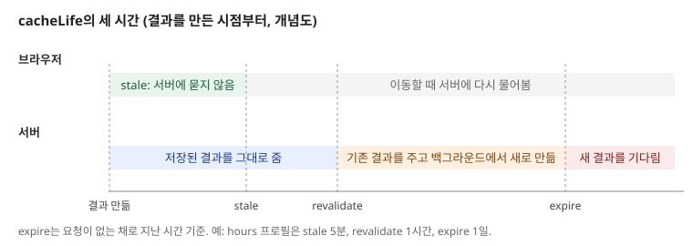
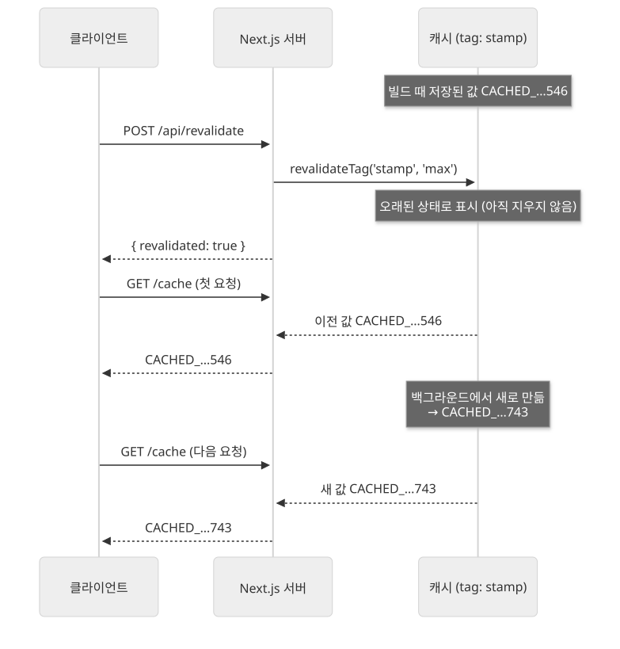

Next.js 16의 Cache Components에서는 캐시할 함수나 컴포넌트에 `'use cache'`를 적어, 그 결과를 여러 요청이 함께 쓰게 합니다.

요청마다 같은 데이터를 다시 읽을 때 무엇이 불편한지 보고, `'use cache'`로 결과를 캐시하는 방법, `cacheLife`로 캐시가 얼마나 오래 유효한지 정하는 방법, 데이터를 바꾼 뒤 캐시를 갱신하는 방법을 살펴봅니다. 캐시한 결과는 빌드 때 미리 그린 화면에 포함되고, 정한 시간이 지나거나 태그로 무효화하면 새로 만들어집니다.

## 요청마다 데이터를 새로 읽을 때의 문제

서버 컴포넌트는 요청이 올 때마다 실행됩니다. 상품 목록처럼 모든 사용자에게 같은 데이터라도, 사용자 천 명이 페이지를 열면 같은 DB 조회가 천 번 실행됩니다.

- **같은 결과를 반복해서 만듭니다.** 몇 시간에 한 번 바뀌는 데이터도 요청마다 다시 읽고 다시 그립니다.
- **DB와 외부 API에 부담이 갑니다.** 조회 수가 사용자 수에 비례해 늘어납니다.
- **응답이 데이터 소스만큼 느립니다.** 조회에 200ms가 걸리면 모든 요청이 그만큼 기다립니다.

## 'use cache'로 결과 캐시하기

Cache Components는 `next.config.ts`의 `cacheComponents: true`로 켭니다. Next.js 16.4의 `create-next-app`으로 만든 프로젝트는 이미 켜져 있습니다.

```ts
// next.config.ts
const nextConfig = {
  cacheComponents: true,
  partialPrefetching: true,
};
```

캐시할 async 함수의 맨 위에 `'use cache'`를 적으면, 그 함수가 돌려준 값을 저장해 두고 다음 호출에서 다시 씁니다.

```ts
import { cacheLife, cacheTag } from 'next/cache';

export async function getProducts() {
  'use cache';
  cacheLife('hours');
  cacheTag('products');
  return db.product.findMany();
}
```

함수의 인자도 캐시를 구분하는 키에 들어갑니다. `getProduct('a')`와 `getProduct('b')`는 따로 저장됩니다.

함수 대신 컴포넌트나 페이지의 맨 위에 적으면 그 컴포넌트가 그린 결과 전체를 캐시합니다. 파일 맨 위에 적으면 그 파일에서 내보내는 모든 함수가 캐시됩니다.

```tsx
export default async function ProductsPage() {
  'use cache';
  cacheLife('hours');
  const products = await db.product.findMany();
  return <ProductList products={products} />;
}
```

캐시한 결과는 빌드할 때 미리 그린 화면에 포함됩니다. `'use cache'`를 적은 함수가 `Date.now()`를 돌려주게 만들고 페이지를 여러 번 요청해 보면, 요청할 때마다 빌드 때 저장된 같은 값이 나옵니다. 반대로 `connection()`을 부른 뒤 `<Suspense>` 안에서 `Date.now()`를 그리면 요청마다 값이 바뀝니다.

```text
'use cache'          요청 1: CACHED_1793694258546   요청 2: CACHED_1793694258546
connection() + Suspense   요청 1: NOW_1793694307679   요청 2: NOW_1793694307698
```

## cacheLife로 캐시 수명 정하기

`cacheLife`는 캐시한 결과를 얼마나 오래 쓸지 정합니다. 세 가지 시간으로 이뤄집니다.

| 시간 | 뜻 |
|---|---|
| `stale` | 브라우저가 서버에 묻지 않고 가진 결과를 그대로 쓰는 시간 |
| `revalidate` | 이 시간이 지난 뒤 요청이 오면, 일단 가진 결과를 주고 백그라운드에서 새로 만듦 |
| `expire` | 요청 없이 이 시간이 지나면, 다음 요청은 새 결과가 만들어질 때까지 기다림 |



시간을 직접 적지 않고 이름이 붙은 프로필을 고를 수 있습니다.

| 프로필 | `stale` | `revalidate` | `expire` | 쓰임 예 |
|---|---|---|---|---|
| `default` | 5분 | 15분 | 없음 | `cacheLife`를 부르지 않았을 때 |
| `seconds` | 30초 | 1초 | 60초 | 실시간에 가까운 데이터 |
| `minutes` | 5분 | 1분 | 1시간 | 자주 바뀌는 피드 |
| `hours` | 5분 | 1시간 | 1일 | 하루에 여러 번 바뀌는 재고, 날씨 |
| `days` | 5분 | 1일 | 1주 | 블로그 글 |
| `weeks` | 5분 | 1주 | 30일 | 주간 콘텐츠 |
| `max` | 5분 | 30일 | 1년 | 거의 바뀌지 않는 약관 |

`cacheLife('hours')`를 쓴 페이지를 빌드하면 빌드 결과의 경로 목록에 그 수명이 표시됩니다.

```text
Route (app)              Revalidate  Expire
├ ○ /cache                       1h      1d
```

`cacheLife`를 부르지 않으면 `default` 프로필이 적용됩니다. 어떤 수명으로 캐시되는지 코드에서 바로 보이도록, `'use cache'`를 쓸 때마다 `cacheLife`를 함께 적는 것이 좋습니다. `seconds`처럼 `expire`가 5분보다 짧은 캐시는 빌드 때 미리 그린 화면에 넣지 않고, 요청 때 채우는 자리로 남깁니다.

> 💡 **여기까지 정리하면**
>
> - Cache Components에서는 `'use cache'`를 적은 함수나 컴포넌트의 결과를 저장해 여러 요청이 함께 씁니다. 인자가 다르면 따로 저장합니다.
> - 캐시한 결과는 빌드 때 미리 그린 화면에 포함됩니다.
> - `cacheLife`의 `stale`, `revalidate`, `expire`로 캐시를 쓰는 시간과 새로 만드는 시점을 정합니다.

## 데이터를 바꾼 뒤 캐시 갱신하기

시간이 지나기 전에 데이터가 바뀌면 캐시를 직접 무효화해야 합니다. 먼저 캐시에 `cacheTag`로 이름표를 붙이고, 데이터를 바꾼 곳에서 그 이름표로 무효화합니다.

```ts
// 캐시하는 쪽
export async function getProducts() {
  'use cache';
  cacheLife('hours');
  cacheTag('products');
  return db.product.findMany();
}
```

```ts
// 데이터를 바꾸는 쪽 (Route Handler)
import { revalidateTag } from 'next/cache';

export async function POST() {
  await db.product.create({ data: { name: 'pen' } });
  revalidateTag('products', 'max');
  return Response.json({ revalidated: true });
}
```

무효화 함수는 세 가지가 있습니다.

| 함수 | 동작 | 쓸 수 있는 곳 |
|---|---|---|
| `revalidateTag(tag, 'max')` | 태그가 붙은 캐시를 오래된 상태로 표시. 다음 요청에는 기존 결과를 주고 백그라운드에서 새로 만듦 | 서버 함수, Route Handler |
| `updateTag(tag)` | 태그가 붙은 캐시를 바로 만료. 다음 요청은 새 결과를 기다림 | 서버 함수 |
| `revalidatePath(path)` | 경로 하나에 쓰인 캐시를 모두 무효화 | 서버 함수, Route Handler |

`revalidateTag`는 바로 지우지 않고 기존 결과를 한 번 더 내보냅니다. 위 예제처럼 `revalidateTag`를 부른 뒤 페이지를 연달아 요청하면, 첫 요청에는 이전 값이, 그다음 요청부터는 새 값이 나옵니다.



글 목록처럼 잠깐 이전 내용이 보여도 되는 데이터는 `revalidateTag`를 씁니다. 사용자가 방금 바꾼 내용을 바로 봐야 한다면, 예를 들어 자기 프로필을 수정한 직후라면 서버 함수에서 `updateTag`를 씁니다. 어떤 태그가 붙었는지 모를 때는 `revalidatePath`로 경로 단위로 무효화하지만, 필요한 것보다 많이 지울 수 있어 태그 방식이 더 정확합니다.

## 사용자마다 다른 데이터

`'use cache'`의 결과는 모든 사용자가 함께 씁니다. 그래서 `cookies()`나 `headers()`처럼 요청마다 다른 값은 `'use cache'` 함수 안에서 바로 읽지 않습니다. 이런 데이터는 다음 중 하나로 다룹니다.

- **캐시하지 않고 스트리밍** — `<Suspense>`로 감싸 요청 때마다 새로 그립니다.
- **값을 꺼내 인자로 넘기기** — 요청에서 사용자 ID를 꺼낸 뒤 캐시 함수에 인자로 넘기면, 사용자 ID별로 캐시가 따로 저장됩니다.

```tsx
// Profile은 <Suspense> 안에서 그립니다 (cookies()는 요청이 와야 읽을 수 있음)
async function Profile() {
  const userId = (await cookies()).get('userId')?.value;
  return <ProfileCard userId={userId} />;
}

async function ProfileCard({ userId }: { userId?: string }) {
  'use cache';
  cacheLife('minutes');
  const user = await db.user.findUnique({ where: { id: userId } });
  return <p>{user?.name}</p>;
}
```

## 언제 무엇을 쓸까?

- **모든 사용자에게 같고 가끔 바뀌는 데이터** — `'use cache'`와 `cacheLife`로 캐시합니다. 바뀌는 주기에 맞춰 `hours`, `days` 같은 프로필을 고릅니다.
- **바뀌는 시점을 아는 데이터** — CMS 글처럼 수정할 때 알림을 받을 수 있다면 `cacheLife('max')`로 오래 캐시하고, 수정할 때 `revalidateTag`로 갱신합니다.
- **사용자가 바꾸고 바로 확인하는 데이터** — 서버 함수에서 `updateTag`를 씁니다.
- **요청마다 달라야 하는 데이터** — 캐시하지 않고 `<Suspense>`로 감싸 스트리밍합니다.

## 정리

- Cache Components에서는 함수나 컴포넌트에 `'use cache'`를 적어 결과를 여러 요청이 함께 쓰게 합니다. 인자도 캐시 키에 들어가고, 캐시한 결과는 빌드 때 미리 그린 화면에 포함됩니다.
- `cacheLife`로 `stale`, `revalidate`, `expire`를 정하고, 프로필 이름으로 흔한 조합을 고릅니다.
- `cacheTag`로 이름표를 붙이고, 데이터를 바꾼 뒤 `revalidateTag`(기존 결과를 주며 백그라운드 갱신)나 `updateTag`(바로 만료)로 갱신합니다.
- 사용자마다 다른 값은 `'use cache'` 안에서 읽지 않고, 스트리밍하거나 인자로 넘겨 따로 캐시합니다.
