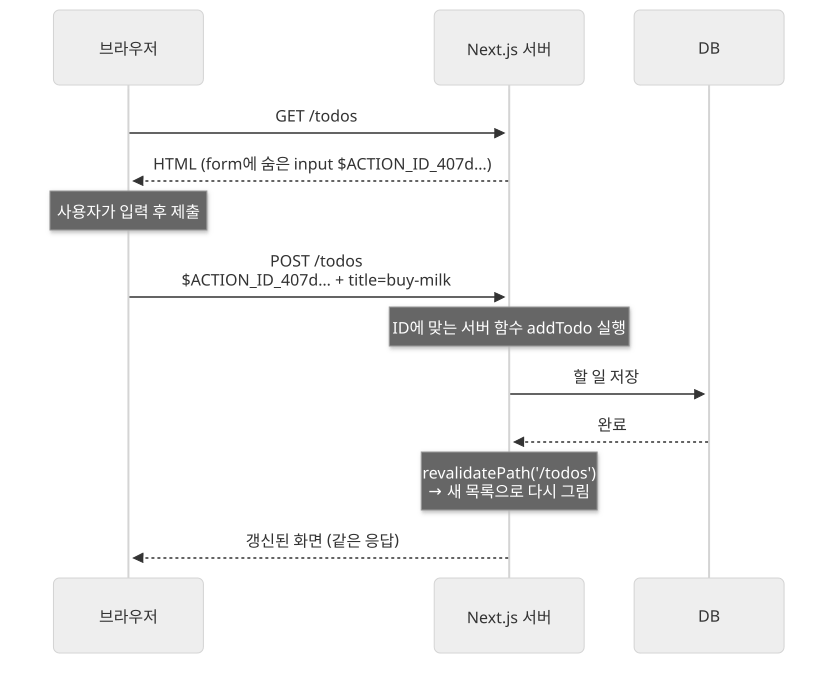

Next.js에서는 데이터를 바꾸는 코드를 `'use server'`를 적은 서버 함수로 만들고, 폼이나 버튼에서 그 함수를 직접 부릅니다.

데이터를 바꾸는 API를 따로 만들 때 무엇이 불편한지 보고, 서버 함수를 만들고 부르는 방법, 바꾼 뒤 화면을 갱신하는 방법, 진행 상태와 오류를 보여주는 방법, 보안 주의점을 살펴봅니다. 브라우저가 서버 함수를 부르면 Next.js가 POST 요청으로 서버에서 그 함수를 실행하고, 바뀐 화면을 같은 응답에 담아 돌려줍니다.

## API를 따로 만들어 데이터를 바꿀 때의 문제

할 일을 추가하는 폼을 API를 따로 두고 만들면 보통 다음 코드가 모두 필요합니다.

1. 서버에 `POST /api/todos` 엔드포인트를 만들고 요청 본문을 읽습니다.
2. 클라이언트 컴포넌트에서 `onSubmit`으로 기본 제출을 막고 `fetch`로 요청을 보냅니다.
3. 응답이 오면 목록을 다시 가져오거나 상태를 직접 고칩니다.

- **한 가지 일에 코드가 세 곳으로 나뉩니다.** 엔드포인트, 요청 코드, 화면 갱신 코드를 따로 관리합니다.
- **요청·응답 형태를 양쪽에서 맞춰야 합니다.** 주소와 본문 형식을 바꾸면 서버와 클라이언트를 함께 고쳐야 합니다.
- **JavaScript가 없으면 폼이 동작하지 않습니다.** `fetch`로 보내므로 JavaScript가 로드되기 전에는 제출할 수 없습니다.

## 서버 함수란

**서버 함수**(Server Function)는 서버에서 실행되는 async 함수로, 클라이언트에서 네트워크 요청을 통해 부를 수 있습니다. 폼 제출처럼 데이터를 바꾸는 데 쓰는 서버 함수를 **서버 액션**(Server Action)이라고도 부릅니다.

함수 본문 맨 위나 파일 맨 위에 `'use server'`를 적어 만듭니다. 파일 맨 위에 적으면 그 파일에서 내보내는 모든 함수가 서버 함수가 됩니다.

```ts
// app/todos/actions.ts
'use server';

import { revalidatePath } from 'next/cache';

export async function addTodo(formData: FormData) {
  const title = String(formData.get('title') ?? '');
  await db.todo.create({ data: { title } });
  revalidatePath('/todos');
}
```

서버 컴포넌트 안에서는 함수 본문에 `'use server'`를 적어 바로 만들 수도 있습니다. 클라이언트 컴포넌트 안에서는 서버 함수를 만들 수 없고, `'use server'` 파일에서 import해서 씁니다.

## 폼에서 서버 함수 부르기

`<form>`의 `action`에 서버 함수를 넘기면, 제출할 때 그 함수가 서버에서 실행됩니다. 함수는 폼 값이 담긴 `FormData`를 받습니다.

```tsx
// app/todos/page.tsx
import { addTodo } from './actions';

export default function TodosPage() {
  return (
    <form action={addTodo}>
      <input name="title" />
      <button type="submit">추가</button>
    </form>
  );
}
```

이 페이지의 HTML을 보면 Next.js가 폼을 이렇게 바꿔 둡니다.

```html
<form action="" encType="multipart/form-data" method="POST">
  <input type="hidden" name="$ACTION_ID_407d5de5…"/>
  …
</form>
```

`$ACTION_ID_…`는 어떤 서버 함수를 실행할지 가리키는 값입니다. 브라우저가 이 폼을 POST로 제출하면, Next.js가 ID에 맞는 서버 함수를 찾아 실행합니다. 일반 HTML 폼이므로 JavaScript가 아직 로드되지 않았거나 꺼져 있어도 동작합니다. 실제로 JavaScript 없이 `curl`로 이 폼 형식 그대로 POST를 보내도 서버에서 `addTodo`가 실행되고, 다시 열어 본 목록에 새 항목이 들어 있습니다.



JavaScript가 로드된 뒤에는 페이지를 새로 고치지 않고 제출하고, 바뀐 화면만 받아 교체합니다.

### 이벤트 핸들러에서 부르기

폼이 아닌 곳에서는 클라이언트 컴포넌트의 이벤트 핸들러에서 일반 async 함수처럼 부릅니다.

```tsx
'use client';
import { likePost } from './actions';

export function LikeButton({ postId }: { postId: string }) {
  return <button onClick={() => likePost(postId)}>좋아요</button>;
}
```

서버 함수는 브라우저가 한 번에 하나씩 순서대로 보냅니다. 여러 데이터를 동시에 읽어야 한다면 서버 함수 대신 서버 컴포넌트에서 읽습니다.

> 💡 **여기까지 정리하면**
>
> - `'use server'`를 적은 async 함수는 서버에서 실행되고, 클라이언트에서 네트워크 요청으로 부를 수 있습니다.
> - `<form action={서버 함수}>`로 넘기면 폼 값이 `FormData`로 전달되고, JavaScript 없이도 제출됩니다.
> - 클라이언트 컴포넌트에서는 `'use server'` 파일에서 import해 이벤트 핸들러에서 부릅니다.

## 바꾼 뒤 화면 갱신하기

데이터를 바꾼 뒤에는 그 데이터를 보여주는 화면도 바뀌어야 합니다. 서버 함수 안에서 다음 함수를 부릅니다.

| 함수 | 하는 일 |
|---|---|
| `revalidatePath('/todos')` | 그 경로에 쓰인 캐시를 무효화하고, 새 화면을 응답에 담음 |
| `updateTag('todos')` | 태그가 붙은 캐시를 바로 만료. 방금 바꾼 내용을 바로 보여줄 때 |
| `refresh()` | 캐시는 그대로 두고 현재 페이지를 다시 그림 |
| `redirect('/todos')` | 다른 페이지로 이동 |

`redirect`는 내부적으로 예외를 던져 함수를 멈추므로, 그 뒤의 코드는 실행되지 않습니다. 캐시 무효화가 필요하면 `redirect`보다 먼저 부릅니다.

```ts
export async function createPost(formData: FormData) {
  'use server';
  const post = await db.post.create({ data: { title: String(formData.get('title')) } });
  revalidatePath('/posts');
  redirect(`/posts/${post.id}`);
}
```

## 진행 상태와 오류 보여주기

제출 중 표시와 오류 메시지는 React의 `useActionState`로 다룹니다. 서버 함수를 넘기면 `[마지막 결과, 폼에 넘길 함수, 진행 중 여부]`를 돌려줍니다.

```tsx
'use client';
import { useActionState } from 'react';
import { addTodo } from './actions';

export function TodoForm() {
  const [state, formAction, pending] = useActionState(addTodo, { error: '' });
  return (
    <form action={formAction}>
      <input name="title" />
      <button disabled={pending}>{pending ? '추가하는 중' : '추가'}</button>
      {state.error && <p>{state.error}</p>}
    </form>
  );
}
```

`useActionState`에 넘기는 서버 함수는 첫 인자로 이전 결과를, 둘째 인자로 `FormData`를 받습니다. 입력값이 비었다처럼 예상할 수 있는 오류는 예외를 던지지 않고 결과 객체로 돌려줍니다.

```ts
'use server';

export async function addTodo(prev: { error: string }, formData: FormData) {
  const title = String(formData.get('title') ?? '').trim();
  if (!title) return { error: '할 일을 입력하세요.' };
  await db.todo.create({ data: { title } });
  revalidatePath('/todos');
  return { error: '' };
}
```

DB 연결 실패처럼 예상하지 못한 오류는 그대로 던지고, 가장 가까운 `error.tsx`가 받게 둡니다.

## 서버 함수의 보안

서버 함수는 앱 화면에서만 부를 수 있는 함수가 아닙니다. 위에서 본 것처럼 `$ACTION_ID`와 값을 담아 POST를 보내면 누구나 실행할 수 있는 공개 엔드포인트입니다. 그래서 서버 함수마다 다음을 직접 확인합니다.

- **인증과 권한** — 로그인한 사용자인지, 이 데이터를 바꿀 권한이 있는지 함수 안에서 확인합니다. 버튼을 숨기는 것만으로는 막을 수 없습니다.
- **입력값 검증** — `FormData`나 인자로 들어온 값은 사용자가 마음대로 바꿔 보낼 수 있으므로, 형식과 범위를 검사한 뒤 씁니다.

```ts
'use server';

export async function deletePost(postId: string) {
  const session = await getSession();
  if (!session) throw new Error('로그인이 필요합니다.');
  const post = await db.post.findUnique({ where: { id: postId } });
  if (post?.authorId !== session.userId) throw new Error('권한이 없습니다.');
  await db.post.delete({ where: { id: postId } });
  revalidatePath('/posts');
}
```

## 언제 서버 함수를 쓸까?

서버 함수가 잘 맞는 경우입니다.

- **앱 화면에서 데이터를 바꾸는 폼과 버튼** — 추가, 수정, 삭제, 좋아요처럼 사용자 동작으로 데이터를 바꿀 때.
- **JavaScript 없이도 동작해야 하는 폼** — 로그인, 검색, 문의처럼 페이지가 로드되기 전에도 제출할 수 있어야 할 때.
- **바꾼 뒤 화면을 바로 갱신해야 할 때** — `revalidatePath`, `updateTag`로 바뀐 화면을 같은 응답에서 받습니다.

다른 방법이 맞는 경우도 있습니다.

- **데이터를 읽기만 할 때** — 서버 컴포넌트에서 읽습니다. 서버 함수는 순서대로 하나씩 실행되어 여러 데이터를 동시에 읽는 데 맞지 않습니다.
- **앱 바깥에서 부르는 API** — 모바일 앱, 외부 서비스의 웹훅처럼 정해진 주소와 HTTP 메서드가 필요한 경우는 Route Handler로 엔드포인트를 만듭니다.

## 정리

- 서버 함수는 `'use server'`를 적은 async 함수입니다. 서버에서 실행되고, 클라이언트에서 POST 요청으로 부릅니다.
- `<form action={서버 함수}>`로 넘기면 폼 값이 `FormData`로 전달되고, 일반 HTML 폼이라 JavaScript 없이도 제출됩니다.
- 데이터를 바꾼 뒤 `revalidatePath`, `updateTag`, `refresh`, `redirect`로 화면을 갱신하고, `useActionState`로 진행 상태와 예상한 오류를 보여줍니다.
- 서버 함수는 누구나 부를 수 있는 공개 엔드포인트이므로, 함수 안에서 인증·권한과 입력값을 직접 확인합니다.
