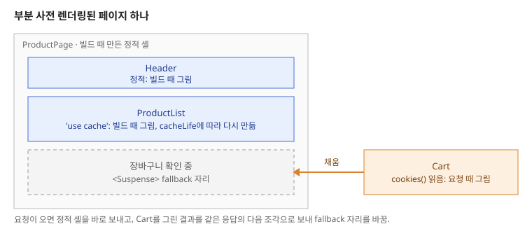

Next.js는 페이지를 빌드할 때 미리 그려 둘지, 요청이 올 때 그릴지를 코드가 읽는 값에 따라 정합니다.

한 가지 방식으로만 그릴 때 무엇이 불편한지 보고, 정적 렌더링과 동적 렌더링이 각각 언제 일어나는지, 두 방식을 한 페이지에 섞는 부분 사전 렌더링, 빌드 결과에서 각 페이지의 방식을 확인하는 방법을 살펴봅니다. 요청 없이 그릴 수 있는 부분은 빌드 때 미리 그리고, 요청이 와야 알 수 있는 부분만 요청 때 채웁니다.

## 한 가지 방식으로만 그릴 때의 문제

페이지를 그리는 시점은 크게 둘입니다.

| | 빌드 때 미리 그림 | 요청 때마다 그림 |
|---|---|---|
| 응답 속도 | 만들어 둔 HTML을 바로 보냄 | 그리는 시간만큼 기다림 |
| 데이터 | 빌드 시점의 데이터로 고정 | 요청 시점의 최신 데이터 |
| 사용자별 내용 | 넣을 수 없음 | 쿠키 등으로 사용자마다 다르게 그림 |

어느 한쪽만 고르면 문제가 생깁니다.

- **모두 미리 그리면** 로그인한 사용자 이름이나 장바구니처럼 요청마다 다른 내용을 넣을 수 없습니다.
- **모두 요청 때 그리면** 대부분이 고정된 페이지도 요청마다 처음부터 그려, 응답이 느리고 서버가 같은 일을 반복합니다.
- **페이지 단위로 고르면** 헤더에 사용자 이름 하나만 들어가도 페이지 전체를 요청 때 그려야 합니다.

## 정적 렌더링과 동적 렌더링

**정적 렌더링**(사전 렌더링, prerendering)은 빌드할 때 페이지를 미리 그려 HTML과 RSC 페이로드로 저장해 두는 방식입니다. 요청이 오면 저장해 둔 결과를 그대로 보냅니다.

**동적 렌더링**은 요청이 올 때 서버에서 그리는 방식입니다.

Next.js는 컴포넌트가 무엇을 읽는지 보고 둘 중 하나를 정합니다. 다음 값을 읽는 컴포넌트는 요청 때 그리고, 나머지는 빌드 때 그립니다.

- `cookies()`, `headers()`, `searchParams`처럼 요청이 와야 알 수 있는 값
- 캐시하지 않은 `fetch`나 DB 조회
- `connection()`을 부른 컴포넌트

`'use cache'`로 캐시한 결과는 요청 값을 읽지 않으므로 빌드 때 그려 정적인 부분에 들어갑니다. 동적 라우트(`[slug]`)는 `generateStaticParams`로 알려준 값만 빌드 때 그립니다.

## 부분 사전 렌더링(PPR)

**부분 사전 렌더링**(Partial Prerendering, PPR)은 한 페이지 안에서 정적인 부분은 빌드 때 그리고, 동적인 부분만 요청 때 그리는 방식입니다. Cache Components(`cacheComponents: true`)를 켜면 이 방식이 기본입니다.

경계는 `<Suspense>`가 정합니다. 빌드할 때 Next.js는 페이지를 그리다가 동적인 컴포넌트를 만나면, 그 컴포넌트를 감싼 `<Suspense>`의 `fallback`으로 자리를 채워 둡니다. 이렇게 미리 그린 HTML을 **정적 셸**(static shell)이라고 합니다.



요청이 오면 서버는 정적 셸을 바로 보내고, 같은 응답 안에서 동적인 부분을 그려 이어서 보냅니다. 2초 걸리는 컴포넌트를 `<Suspense>`로 감싼 페이지를 재 보면, 정적 셸이 43ms에 도착하고 동적인 내용은 2053ms에 같은 응답으로 도착합니다.

```tsx
export default function ProductPage() {
  return (
    <main>
      <Header />            {/* 정적: 빌드 때 그림 */}
      <ProductList />       {/* 'use cache': 빌드 때 그림 */}
      <Suspense fallback={<p>장바구니 확인 중</p>}>
        <Cart />            {/* cookies()를 읽음: 요청 때 그림 */}
      </Suspense>
    </main>
  );
}
```

이 방식에서는 `cookies()`를 읽는 컴포넌트가 하나 있어도 페이지 전체가 동적으로 바뀌지 않습니다. 그 컴포넌트를 감싼 `<Suspense>` 안만 요청 때 그립니다. Cache Components를 켜지 않은 이전 방식에서는 페이지의 어디에서든 `cookies()`를 읽으면 그 페이지 전체를 요청 때 그렸습니다.

> 💡 **여기까지 정리하면**
>
> - 정적 렌더링은 빌드 때, 동적 렌더링은 요청 때 그립니다. 요청 값이나 캐시하지 않은 데이터를 읽는 컴포넌트가 동적이 됩니다.
> - 부분 사전 렌더링은 한 페이지 안에서 정적인 부분을 정적 셸로 미리 그리고, `<Suspense>` 안의 동적인 부분만 요청 때 채웁니다.
> - Cache Components를 켜면 부분 사전 렌더링이 기본이고, 동적인 컴포넌트는 `<Suspense>`로 감싸야 합니다.

## 빌드 결과에서 확인하기

`next build`가 끝나면 경로마다 어떤 방식으로 그렸는지 기호로 표시됩니다.

```text
Route (app)              Revalidate  Expire
┌ ○ /
├ ƒ /api/items
├ ○ /api/static-only
├   /blog/[slug]
│ ├ ◐ /blog/[slug]
│ ├ ○ /blog/hello
│ └ ○ /blog/world
├ ƒ /blocking
├ ○ /cache                       1h      1d
├ ◐ /stream

○  (Static)             prerendered as static content
◐  (Partial Prerender)  prerendered as static HTML with dynamic server-streamed content
ƒ  (Dynamic)            server-rendered on demand
```

| 기호 | 방식 | 위 예에서 |
|---|---|---|
| `○` | 정적. 빌드 때 전부 그림 | `/`는 요청 값을 읽지 않음. `/cache`는 `'use cache'`로 캐시했고, `cacheLife('hours')`에 따라 1시간 뒤 다시 만듦 |
| `◐` | 부분 사전 렌더링. 정적 셸 + 요청 때 채우는 부분 | `/stream`은 `<Suspense>` 안에서 `connection()`을 부름 |
| `ƒ` | 동적. 요청 때 전부 그림 | `/blocking`은 `export const instant = false`로 페이지 전체가 요청 때 데이터를 기다리게 함 |

동적 라우트는 아래에 값별로 나옵니다. `generateStaticParams`로 알려준 `/blog/hello`, `/blog/world`는 `○`로 미리 그려졌고, 그 밖의 값을 맡는 `/blog/[slug]`는 `◐`입니다.

Route Handler도 같은 기호로 표시됩니다. 요청 값을 읽지 않는 `GET`만 있는 `/api/static-only`는 `○`로 빌드 때 응답을 만들어 두고, 요청 본문을 읽는 `POST`가 같은 파일에 있는 `/api/items`는 `ƒ`입니다.

배포 전에 이 목록을 보면, 미리 그려질 거라 생각한 페이지가 `ƒ`로 바뀌지 않았는지 확인할 수 있습니다.

## 언제 어떤 방식이 될까?

- **모든 사용자에게 같은 페이지** — 소개, 약관, 문서처럼 요청 값을 읽지 않으면 `○` 정적 렌더링이 됩니다.
- **가끔 바뀌는 데이터를 보여주는 페이지** — 데이터를 `'use cache'`와 `cacheLife`로 캐시하면 `○`로 미리 그리고 정해진 주기로 다시 만듭니다.
- **대부분 같고 일부만 사용자별로 다른 페이지** — 사용자별 부분만 `<Suspense>`로 감싸면 `◐` 부분 사전 렌더링이 됩니다.
- **페이지 전체가 요청마다 달라야 하는 경우** — 검색 결과처럼 페이지 대부분이 요청 값에 따라 바뀌면 동적인 부분이 넓어집니다. 이때도 `<Suspense>`로 먼저 보낼 수 있는 부분을 나누면 첫 화면이 빨라집니다.

## 정리

- 정적 렌더링은 빌드 때 HTML을 미리 그려 두고, 동적 렌더링은 요청 때 그립니다. 요청 값, 캐시하지 않은 데이터, `connection()`을 읽는 컴포넌트가 동적이 됩니다.
- 부분 사전 렌더링은 정적인 부분을 정적 셸로 미리 그리고, `<Suspense>` 안의 동적인 부분만 요청 때 같은 응답으로 이어 보냅니다. Cache Components를 켜면 기본입니다.
- `next build` 결과의 `○`(정적), `◐`(부분 사전 렌더링), `ƒ`(동적) 기호로 각 경로의 방식을 확인합니다.
