Next.js에서 화면 대신 JSON 같은 HTTP 응답을 돌려줄 때는 Route Handler를, 요청이 페이지에 닿기 전에 처리할 때는 Proxy를 씁니다.

페이지만으로는 무엇을 할 수 없는지 보고, `route.ts`로 엔드포인트를 만드는 방법, Proxy로 요청을 가로채 리다이렉트하거나 헤더를 바꾸는 방법, 서버 함수와 비교해 언제 무엇을 쓰는지 살펴봅니다. 요청은 먼저 Proxy를 거치고, 그다음 주소에 맞는 `page.tsx`나 `route.ts`가 응답합니다.

## 페이지만으로 처리할 수 없는 요청

`page.tsx`는 화면을 돌려줍니다. 그런데 앱에는 화면이 아닌 응답이 필요한 요청도 있습니다.

- **앱 밖에서 부르는 API** — 모바일 앱이 데이터를 가져가거나, 결제 서비스가 결과를 알려주는 웹훅을 보냅니다. 정해진 주소와 HTTP 메서드, JSON 응답이 필요합니다.
- **파일 응답** — CSV 내보내기나 이미지 생성처럼 HTML이 아닌 응답을 돌려줍니다.
- **여러 페이지에 공통으로 할 일** — 예전 주소를 새 주소로 보내거나, 모든 응답에 헤더를 붙이는 일을 페이지마다 넣으면 같은 코드가 반복됩니다.

## Route Handler로 엔드포인트 만들기

**Route Handler**는 `app` 폴더 안의 `route.ts` 파일로 만드는 HTTP 엔드포인트입니다. 폴더 구조가 주소가 되는 것은 `page.tsx`와 같고, 파일에서 HTTP 메서드 이름으로 함수를 내보냅니다.

```ts
// app/api/items/route.ts → /api/items
export async function GET() {
  return Response.json([{ id: 1, name: 'pen' }]);
}

export async function POST(request: Request) {
  const body = await request.json();
  return Response.json({ created: body }, { status: 201 });
}
```

함수는 웹 표준 `Request`를 받고 `Response`를 돌려줍니다. 실행해 보면 다음과 같이 응답합니다.

```text
$ curl localhost:3000/api/items
[{"id":1,"name":"pen"}]

$ curl -X POST -H 'content-type: application/json' -d '{"name":"cup"}' localhost:3000/api/items
{"created":{"name":"cup"}}          # 상태 코드 201

$ curl -X DELETE localhost:3000/api/items
                                    # 상태 코드 405
```

내보낼 수 있는 메서드는 `GET`, `POST`, `PUT`, `PATCH`, `DELETE`, `HEAD`, `OPTIONS`입니다. 파일에 없는 메서드로 요청하면 `405 Method Not Allowed`를 돌려줍니다.

같은 폴더에 `page.tsx`와 `route.ts`를 함께 둘 수는 없습니다. 한 주소를 화면과 API가 동시에 맡을 수 없기 때문이고, 함께 두면 빌드할 때 다음 오류가 납니다.

```text
Conflicting route and page at /conflict: route at /conflict/route and page at /conflict/page
```

그래서 Route Handler는 보통 `app/api/` 아래에 모읍니다.

### 요청 값 읽기

주소의 동적 값은 둘째 인자의 `params`로, 쿼리 문자열은 `NextRequest`의 `nextUrl.searchParams`로 읽습니다. `params`는 페이지와 마찬가지로 Promise입니다.

```ts
// app/api/items/[id]/route.ts → /api/items/3?fields=name
import type { NextRequest } from 'next/server';

export async function GET(request: NextRequest, { params }: { params: Promise<{ id: string }> }) {
  const { id } = await params;
  const fields = request.nextUrl.searchParams.get('fields');
  return Response.json({ id, fields });
}
```

### 응답을 빌드 때 만들어 두는 경우

Cache Components를 켜면 `GET` Route Handler도 페이지와 같은 규칙으로 미리 만들어 둘 수 있습니다. `GET`만 있고 요청 값이나 캐시하지 않은 데이터를 읽지 않으면, 빌드할 때 응답을 만들어 두고 그대로 돌려줍니다. 빌드 결과에서 `GET`만 있는 `/api/static-only`는 `○`(정적)로, 요청 본문을 읽는 `POST`가 같은 파일에 있는 `/api/items`는 `ƒ`(동적)로 표시됩니다.

```text
├ ƒ /api/items
├ ○ /api/static-only
```

> 💡 **여기까지 정리하면**
>
> - Route Handler는 `route.ts`에서 HTTP 메서드 이름으로 함수를 내보내 만드는 엔드포인트입니다. 웹 표준 `Request`를 받고 `Response`를 돌려줍니다.
> - 없는 메서드는 405로 응답하고, 같은 폴더에 `page.tsx`와 함께 둘 수 없습니다.
> - 요청 값을 읽지 않는 `GET`만 있으면 빌드 때 응답을 만들어 둡니다.

## Proxy로 요청 가로채기

**Proxy**는 요청이 페이지나 Route Handler에 닿기 전에 실행되는 코드입니다. Next.js 15까지는 Middleware라고 불렀고, 16부터 이름이 Proxy로 바뀌었습니다. 하는 일은 같습니다.

프로젝트 루트(`app`과 같은 위치)에 `proxy.ts`를 하나 두고 `proxy` 함수를 내보냅니다. 요청을 보고 다음 중 하나를 합니다.

- **리다이렉트** — 다른 주소로 보냅니다.
- **리라이트** — 주소는 그대로 두고 다른 경로의 응답을 보여줍니다.
- **헤더 수정** — 요청이나 응답의 헤더를 바꿉니다.
- **그대로 통과** — `NextResponse.next()`로 원래 경로가 응답하게 합니다.

```ts
// proxy.ts
import { NextResponse, type NextRequest } from 'next/server';

export function proxy(request: NextRequest) {
  if (request.nextUrl.pathname === '/old-blog') {
    return NextResponse.redirect(new URL('/blog', request.url));
  }
  const res = NextResponse.next();
  res.headers.set('x-proxy', 'passed');
  return res;
}

export const config = { matcher: ['/old-blog', '/blog/:path*'] };
```

`config.matcher`는 Proxy를 실행할 경로입니다. 위 설정으로 요청을 보내면 다음과 같습니다.

| 요청 | 결과 |
|---|---|
| `/old-blog` | `307` 응답으로 `/blog`로 리다이렉트 |
| `/blog` | 페이지가 응답하고, 응답 헤더에 `x-proxy: passed`가 붙음 |
| `/cart` | `matcher`에 없어 Proxy를 거치지 않음. `x-proxy` 헤더 없음 |



Proxy는 모든 요청 앞에서 실행되므로 빠르게 끝나야 합니다. 느린 데이터 조회를 넣지 않고, 로그인 여부에 따라 리다이렉트하는 정도의 가벼운 확인에만 씁니다. 권한 검사는 Proxy만 믿지 않고, 데이터를 읽고 바꾸는 서버 컴포넌트·서버 함수·Route Handler 안에서 다시 합니다. 주소만 바꾸는 단순한 리다이렉트라면 Proxy 대신 `next.config.ts`의 `redirects` 설정을 먼저 씁니다.

## Route Handler, 서버 함수, Proxy 비교

| | Route Handler | 서버 함수 | Proxy |
|---|---|---|---|
| 만드는 곳 | `app/**/route.ts` | `'use server'` 함수 | 루트의 `proxy.ts` 하나 |
| 부르는 쪽 | 누구나 (주소와 메서드로) | 앱의 폼·이벤트 핸들러 | 매칭된 모든 요청 앞에서 자동 |
| HTTP 메서드 | `GET`, `POST` 등 직접 정함 | `POST`만 | 요청 그대로 |
| 응답 | `Response`를 직접 만듦 | 함수 반환값과 갱신된 화면 | 리다이렉트·리라이트·헤더 변경 또는 통과 |
| 주 용도 | 외부에 공개하는 API, 웹훅, 파일 응답 | 앱 화면에서 데이터 바꾸기 | 경로 이동, 공통 헤더, 가벼운 확인 |

## 언제 무엇을 쓸까?

- **모바일 앱이나 외부 서비스가 부르는 API** — Route Handler로 정해진 주소와 메서드를 만듭니다.
- **웹훅 받기** — 결제·CMS 같은 서비스가 보내는 `POST`를 Route Handler로 받고, 필요하면 그 안에서 `revalidateTag`로 캐시를 갱신합니다.
- **앱 화면의 폼과 버튼** — Route Handler보다 서버 함수가 코드가 짧고, 바뀐 화면을 같은 응답으로 받습니다.
- **예전 주소 정리, 공통 헤더, 로그인 여부에 따른 이동** — Proxy를 씁니다. 고정된 주소 이동은 `redirects` 설정으로 충분합니다.

## 정리

- Route Handler는 `route.ts`에서 `GET`, `POST` 같은 메서드 이름으로 함수를 내보내 만드는 엔드포인트입니다. 웹 표준 `Request`와 `Response`를 쓰고, 같은 폴더에 `page.tsx`와 함께 둘 수 없습니다.
- 요청 값을 읽지 않는 `GET`만 있는 Route Handler는 빌드 때 응답을 만들어 둡니다.
- Proxy는 루트의 `proxy.ts` 하나로, `matcher`에 맞는 요청이 페이지에 닿기 전에 리다이렉트·리라이트·헤더 변경을 합니다. Next.js 16에서 Middleware의 이름이 바뀐 것입니다.
- 외부에 공개하는 API는 Route Handler, 앱 화면의 데이터 변경은 서버 함수, 요청 앞단의 가벼운 처리는 Proxy가 맡습니다.
